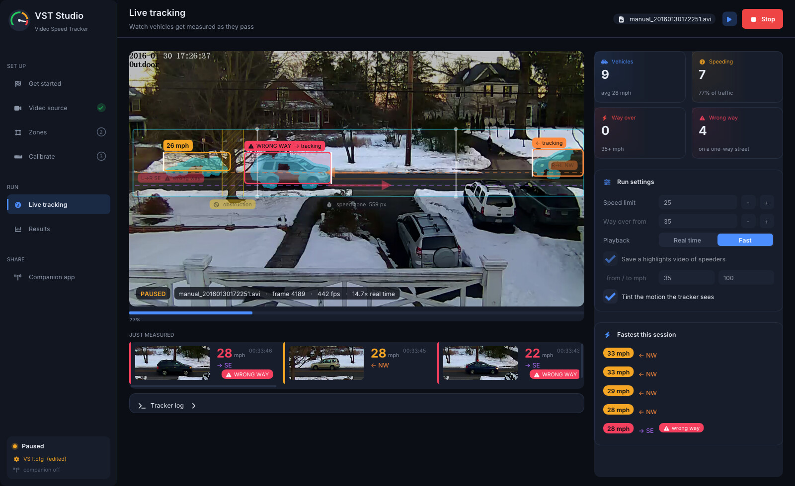

# VideoSpeedTracker
The Video Speed Tracker (VST) is an open source, technically sound, vehicle speed measuring system
that can track bidirectional traffic, one lane in each direction (e.g. a typical residential street).
Beyond a typical home computer, VST requires video from an HD camera, many of which can be purchased
for less than $100 (e.g. the Foscam Fi9103EP, power over Ethernet, outdoor camera.  If you buy a POE camera,
be sure to buy something like the TP-LINK TL-PoE150S - about $18 - to power it.).

As of 31 March 2016, watch the use of the speed tracker in support of documenting Charlottesville, Virginia's current struggles with urban vehicular assault in its established residential neighborhoods at http://eyetach.github.io/CharlottesvilleSpeeds/.

*Note:* that site is no longer online; an [archived copy from May 2016](https://web.archive.org/web/20160521015116/http://eyetach.github.io:80/CharlottesvilleSpeeds/)
is available on the Internet Archive.

Video example:

[](http://www.youtube.com/watch?v=1HVkKysDvGA "Video Speed Tracker on a 25 MPH Residential Street")

## VST Studio

Every release includes **VST Studio**, a desktop app that walks you through the whole job: what camera to get,
whether your window gives enough view (a site planner), drawing the zones on the picture instead of editing
`VST.cfg`, calibrating with one drive past and checking it with a second, watching vehicles get measured live,
reviewing speeders and wrong-way drivers on one-way streets, and printing a street report for the city. A phone can
pair with it to check the camera, help calibrate from the curb and see recent speeders.
See [docs/vst-studio.md](docs/vst-studio.md).



## Set-up Checklist

1. You really want 100 feet or more of open view (a maple tree trunk in the foreground is OK) of
the street. Your speed measuring zone should be at least one second wide for a vehicle going
the speed limit. For a speed limit of 25 MPH, that’s about 37 feet. My speed measuring zone is
1-1/3 seconds wide, which translates to about 50 feet for a vehicle going 25 MPH. I’ve been
able to track vehicles up to 71 MPH (Blue line on the front bumper the whole way!).

   *Note:* that's for whole-frame timing. A narrow street seen from a front window works too: with short-view timing
   (one click in VST Studio's site planner) about 14 ft of clear street is enough. At 30 fps a 15 ft view times cars up
   to about 45 mph; at 60 fps, over 70.

2. You need an HD (1280 x 720) video input stream for the stretch of street you want to analyze.
That requires a camera. I’m using the Foscam FI9803EP outdoor, HD, power over ethernet
camera. It’s about $90 online. I have no particular loyalty to Foscam, but I can say I’ve had
about a half dozen of their cameras and only one (an FI9821) has developed an issue (when it
pans, the video signal cuts out). That’s a decent record for an inexpensive cam that does HD
and 30FPS. My 9803EP has been working about four weeks, including through the infamous
Middle Atlantic January 2016 Snowzilla.

   *Note:* the OpenCV 4 build accepts any resolution (frames are scaled to the 1280 x 720 coordinates VST.cfg uses)
   and any frame rate (speeds are scaled by `CalibrationFPS`). 720p or better at 25–30 fps is still what to aim for.

3. Aim the camera well. Aim the camera so that the street passes left to right
about half way up the overall image. This should minimize the effects of lens distortion. A
vehicle moving a constant velocity cross the lens moves at different pixel rates, frame to frame,
as it proceeds from an edge towards the center and back towards the far edge. My tracker is
what’s known as a “piecewise, linear least squares” tracker. The piecewise part (throwing out
the oldest data) is what allows it to adapt to changing pixel rates as a vehicle moves through
the scene. Setting up as you see in Figure 2 of the included overview
([Overview and User Manual](docs/Video%20Speed%20Tracker%20Overview%20and%20User%20Manual.md)) helps the tracker produce high quality results.

4. If you’re recompiling, you’ll need OpenCV 2.4.11 installed to have a successful compile.

   *Note:* the [CMake build](#building-from-source) added later uses OpenCV 5 (or 4) instead, and the
   [release packages](#downloads) are built on OpenCV 5.

5. Set critical one time setup values in VST.cfg. These values are described in the appendix of the included [pdf](docs/Video%20Speed%20Tracker%20Overview%20and%20User%20Manual_v3.pdf) under docs
([Markdown version](docs/Video%20Speed%20Tracker%20Overview%20and%20User%20Manual.md#appendix)).
   Keys can be in any order and any letter case, blank and `#` comment lines are fine, and a key left out keeps its
   built-in default. See [Calibrating speed](#calibrating-speed).

6. Create a location (the “prefixPath”) for five directories used by VST (and the final highlights
video processor):

   1. IPCam – You put directories for (typically) daily collections of .avi video files here.

   2. HiLites – VST outputs highlights videos into this directory

      1. forPosting – Subdirectory for output of final highlights video processor

   3. Stats – VST puts csv files with tracked vehicle data here

   4. Trace – VST puts debug files here.

All of the files VST creates are given names derived from the input video file name (or the video file
directory if you answer “*” when asked for which file in a directory full of video files to process.) For
the IPCam directory, I create subdirectories with syntax yyyymmdd (e.g. 20160205) in which I place
that day’s video files.

*Note:* when no `VST.cfg` is in the working directory and `--config` isn't given, the first run creates a per-user
config and these folders for you (see [Where config and data live](#where-config-and-data-live)). A blank
`dataPathPrefix`, as shipped, means that per-user data folder. Interactive mode also creates `Stats`, `Trace` and
`HiLites` under `dataPathPrefix` if they are missing. When `IPCam` has no folder of videos yet, it says so and offers
to run the bundled sample instead.

## Downloads

Prebuilt binaries are attached to each [GitHub release](https://github.com/joekiller/VideoSpeedTracker/releases),
built from the CMake sources against OpenCV 5 by `.github/workflows/release.yml`:

| Platform | File | Install |
|---|---|---|
| Debian 12 / 13, Raspberry Pi OS (64-bit), Ubuntu 24.04 / 26.04 — amd64 and arm64 | `videospeedtracker_<ver>_<distro>_<arch>.deb` | `sudo apt install ./videospeedtracker_*.deb` (OpenCV is built in; apt pulls in FFmpeg and GTK) |
| Windows x64 | `VideoSpeedTracker-<ver>-windows-x64-setup.exe` | run it: installs for you (no admin prompt) or for everyone, adds **VST Studio** to the Start menu, and uninstalls from Settings › Apps. Your config and results stay put across upgrades and uninstalls |
| Windows x64, portable | `VideoSpeedTracker-<ver>-windows-x64.zip` | unzip anywhere; OpenCV is built in, the FFmpeg and MSVC runtime DLLs sit next to the exes |
| macOS (Apple silicon) | `VideoSpeedTracker-<ver>-macos-arm64.dmg` | open the disk image and drag **VSTStudio.app** onto Applications. That one app is everything (macOS 13 or later, nothing else to install): the command-line tools, templates and docs are inside it ([below](#macos-command-line-tools)) |
| macOS, archive | `VideoSpeedTracker-<ver>-macos-arm64.tar.gz` | the same app: untar, move **VSTStudio.app** to Applications and open it |

Every package includes the 2016 sample video and a `VST.cfg` set up for it. Open **VST Studio** first: it starts on
the sample and walks you through your own camera. On the command line, the first thing to run is
`VideoSpeedTracker --demo`. [Getting started](docs/getting-started.md) (installed as `GETTING-STARTED.md`) then walks
through setting VST up for your own camera: geometry, calibration and batch runs.

To cut a release, push a version tag (`git tag v1.0.0 && git push origin v1.0.0`), or from the web page run
**Actions > cut-release > Run workflow** with the version (it tags main and starts the release build). The workflow
builds and tests every platform, uploads the packages and a `SHA256SUMS` file to a draft, and publishes it last.
Don't publish the release in the GitHub UI yourself: releases are immutable, so a release published before its
packages can never get them.

### Verifying a download

Every package, on every platform, is signed by GitHub at build time with an [artifact attestation](https://docs.github.com/en/actions/security-for-github-actions/using-artifact-attestations)
(Sigstore-backed SLSA build provenance). It proves the file's exact bytes came out of this repository's release
workflow, on a GitHub-hosted runner, from the tagged commit; it has no long-lived key that could leak. With the
[GitHub CLI](https://cli.github.com/), pinning the workflow and tag so a file built any other way fails:

```
gh attestation verify videospeedtracker_1.8.0_ubuntu-24.04_arm64.deb -R joekiller/VideoSpeedTracker \
  --signer-workflow joekiller/VideoSpeedTracker/.github/workflows/release.yml \
  --source-ref refs/tags/v1.8.0 --deny-self-hosted-runners
```

`SHA256SUMS` lists every file in the release, and is itself attested, so one check covers a whole download folder
(from v1.8.0 on). `SHA256SUMS.sigstore.json` is that signature as a file, for checking later or without access to
GitHub's attestation API:

```
gh attestation verify SHA256SUMS --bundle SHA256SUMS.sigstore.json -R joekiller/VideoSpeedTracker \
  --signer-workflow joekiller/VideoSpeedTracker/.github/workflows/release.yml --source-ref refs/tags/v1.8.0
sha256sum -c SHA256SUMS --ignore-missing        # macOS: shasum -a 256 -c SHA256SUMS --ignore-missing
```

The `.deb` files have no separate GPG signature: apt checks signatures on repositories, not on a `.deb` installed
from a file, so the attestation is the Linux signature (see [docs/code-signing.md](docs/code-signing.md#linux-and-checksums-build-provenance)).
These attestations are not Windows Authenticode or Apple notarization; tag releases carry those separately (below).
To check a macOS download yourself, in the opened disk image or untarred folder (checking the app covers the
command-line tools inside it, which are signed and notarized with it):

```
spctl -a -t open --context context:primary-signature -vv VideoSpeedTracker-*.dmg   # the image: Notarized Developer ID
codesign -dv --verbose=4 VSTStudio.app      # Authority=Developer ID Application: …, Runtime Version, Timestamp
spctl -a -t exec -vv VSTStudio.app          # accepted, source=Notarized Developer ID
xcrun stapler validate VSTStudio.app        # The validate action worked!
spctl -a -t install -vv VideoSpeedTracker   # the command-line tools: source=Notarized Developer ID (online check)
```

Unsigned builds (from `main` or a fork) are refused by Gatekeeper; clear the quarantine with
`xattr -dr com.apple.quarantine .` in the untarred folder (or on the copied app).

### Code signing (optional)

Releases build and publish unsigned until signing is configured; each platform's signing steps switch on by
themselves once its secrets exist. Only tag builds are signed. Windows uses Azure Artifact Signing (about
$9.99/month, signed in through GitHub OIDC, no stored client secret); macOS uses an Apple Developer ID with
notarization ($99/year). Setup steps and troubleshooting: [docs/code-signing.md](docs/code-signing.md).

### Where config and data live

Without `--config`, each program uses `VST.cfg` / `ProcessHiLites.cfg` from the working directory if one is there
(the original 2016 workflow), otherwise its per-user copy. The first run creates that copy from the template installed
with the program, points its `dataPathPrefix` at the per-user data folder, and creates `IPCam`, `HiLites/forPosting`,
`Stats` and `Trace` inside it. The install folder is never written, so the same binaries work from a .deb, an unzipped
folder, or a Store/MSIX or `.app` package. The shipped templates leave `dataPathPrefix` blank, which also means the
per-user data folder, so running from the unzipped Windows folder (where the template is the working-directory
`VST.cfg`) uses the same place.

| | Config | Data |
|---|---|---|
| Linux | `$XDG_CONFIG_HOME/videospeedtracker` (`~/.config/videospeedtracker`) | `$XDG_DATA_HOME/videospeedtracker` (`~/.local/share/videospeedtracker`) |
| Windows | `%APPDATA%\VideoSpeedTracker` | `%LOCALAPPDATA%\VideoSpeedTracker` |
| macOS | `~/Library/Application Support/VideoSpeedTracker` | `~/Library/Application Support/VideoSpeedTracker/Data` |

Each run prints the config file it used.

### macOS command-line tools

The macOS download is a single `VSTStudio.app`; opening it starts VST Studio. The command-line programs and the
files that ship with them live inside the bundle (Finder: right-click VSTStudio.app › Show Package Contents):

| | |
|---|---|
| `VSTStudio.app/Contents/MacOS/` | `VideoSpeedTracker`, `ProcessHiLites` (and `VSTStudio` itself) |
| `VSTStudio.app/Contents/Frameworks/` | the FFmpeg libraries all three load (LGPL 2.1, built by `packaging/build-ffmpeg.sh`) |
| `VSTStudio.app/Contents/Resources/` | `VST.cfg` and `ProcessHiLites.cfg` templates, `README.md`, `GETTING-STARTED.md`, `LICENSE.txt`, `licenses/`, the sample video and the phone companion |

To run them by name, link them into a folder on your `PATH` (they still find their templates, the sample and their
libraries through the link):

```
sudo mkdir -p /usr/local/bin
sudo ln -sf /Applications/VSTStudio.app/Contents/MacOS/{VideoSpeedTracker,ProcessHiLites} /usr/local/bin/
VideoSpeedTracker --demo
```

Don't edit the templates inside the app: that breaks its signature, and an update replaces them anyway. Each program
copies its template to `~/Library/Application Support/VideoSpeedTracker` the first time it runs, and that copy is
the one to edit.

### Licenses

VST is BSD 3-Clause ([LICENSE](LICENSE)); every package includes it. Every package links OpenCV (Apache 2.0) and its
bundled third-party code statically. The Windows zip also ships OpenCV's FFmpeg plugin and the macOS app ships the
FFmpeg libraries in `Contents/Frameworks` (both LGPL 2.1, dynamically loaded). License texts are in
`licenses/opencv` (Windows), `VSTStudio.app/Contents/Resources/licenses/{opencv,ffmpeg}` (macOS) or
`/usr/share/doc/videospeedtracker/opencv` (Linux). FFmpeg and GTK on Linux come from apt with their own licenses.

The original 2016 Win7 x64 executables and OpenCV 2.4.11 DLLs that used to live in `bin/` have been removed; they are
still in the git history before the release workflow was added. Every package contains `VideoSpeedTracker`, the
highlights editor `ProcessHiLites` and the desktop app `VSTStudio`, with their sample configs. VST Studio's own
libraries and fonts (GLFW, Dear ImGui, cpp-httplib, nlohmann/json, QR Code generator, Inter, Font Awesome Free) are
linked in; their licenses are installed next to OpenCV's.

## Building from source

The sources under `src/Wintel64` build with CMake (3.16 or newer, C++17) against OpenCV 4 or 5; CMake stops with an
error on anything older. The distro's OpenCV 4 is the quickest start (tested with 4.6 on Ubuntu 24.04, which is what
`.github/workflows/build.yml` uses):

```
sudo apt-get install libopencv-dev cmake g++
cmake -S . -B build && cmake --build build -j
ctest --test-dir build
```

`ctest` runs three checks: the bundled 2016 sample video against `tests/baseline_*.csv` (same vehicles and directions,
speeds within 1 MPH), the `VST.cfg` parser and argument errors, and the first-run per-user config (Linux and macOS
only).

### Pre-commit hook and CI

Pull requests get one CI job (Linux, `.github/workflows/build.yml`), and only when they touch code, tests or config.
The full release matrix (six Linux packages, Windows and macOS) runs only after a merge to main, so a change that
breaks a platform shows up there rather than on the PR. Catch what you can before committing by turning on the repo's hook once per clone:

```
git config core.hooksPath .githooks
```

`.githooks/pre-commit` looks at what is staged: companion changes run `node --test companion/test/*.test.mjs`, and
changes under `src/`, `tests/`, `bin/`, `cmake/`, `sampleData/` or `CMakeLists.txt` rebuild `build/` (or
`$VST_BUILD_DIR`) and run `ctest`, leaving the two slow real-time tests to CI unless `VST_HOOK_FULL=1`. `git commit --no-verify` skips it.
To run the full matrix on a branch before merging, start the release workflow by hand:
`gh workflow run release.yml --ref <branch>`.

To build what the release packages use instead:

- **Linux:** `packaging/build-opencv.sh /opt/opencv` builds a static OpenCV 5.0.0 (it needs the FFmpeg and GTK 3
  `-dev` packages listed in `.github/workflows/release.yml`), then add `-DCMAKE_PREFIX_PATH=/opt/opencv` to the first
  `cmake` line.
- **macOS:** `brew install opencv cmake`, then
  `cmake -S . -B build -DCMAKE_PREFIX_PATH="$(brew --prefix opencv)"`.
- **Windows** (Visual Studio 2022 and Git Bash): `packaging/build-opencv.sh C:/opencv`, then
  `cmake -S . -B build -A x64 -DCMAKE_PREFIX_PATH=C:/opencv -DOpenCV_STATIC=ON` and
  `cmake --build build --config Release`. Put the `opencv_videoio_ffmpeg*_64.dll` found under `C:\opencv` next to the
  exes (or its folder on `PATH`) so videos can be decoded; run the tests with `ctest --test-dir build -C Release`.

`OPENCV_VERSION=<tag>` makes `build-opencv.sh` build another OpenCV tag.

Run with no arguments for the original interactive mode. Pass options to skip the prompts and run without windows:

```
build/VideoSpeedTracker --headless \
  --input sampleData/IPCam/20160130/manual_20160130172251.avi \
  --config bin/VST.cfg --stats stats.csv --speed-limit 25 \
  --highlights hilites.mp4 --hl-min 35
```

`--help` lists every option; `--opt=value` works too. Without `--stats` the csv is `stats_<input name>.csv` in the
working directory, and `--egregious` defaults to the speed limit + 10. The 8.6 minute sample processes in about
20 seconds headless (roughly 25× real time).

`ProcessHiLites` (the highlights editor, also built by CMake) steps through a highlights video one vehicle at a time
and writes the ones you keep, cropped to 640×360 at (`CropLeft`, `CropTop`), to `forPosting/forPost_<name>` in the input
video's folder. It needs a display. With no arguments it finds `ProcessHiLites.cfg` the same way VST finds `VST.cfg`
(working directory, else the per-user copy) and offers the `.avi` and `.mp4` files in `<dataPathPrefix>/HiLites` one at
a time; or name the files directly:

```
build/ProcessHiLites --config bin/ProcessHiLites.cfg --input hilites.mp4 [--output keepers.mp4]
```

Unlike `VST.cfg`, `ProcessHiLites.cfg` keeps the strict 2016 format: exactly three settings, `dataPathPrefix`,
`CropLeft` and `CropTop`, in that order. Blank lines and trailing `# comments` are fine; comment-only lines are not.

## Calibrating speed

VST doesn't know distances. It measures how many frames a vehicle takes to cross the speed zone between the two white
lines and compares that with a calibration run:

```
speed = CalibrationSpeed × CalibrationFrames × (video fps / CalibrationFPS) / frames taken
```

Record yourself driving through the zone in each direction at a steady, known speed, count the frames each pass took,
and put them in `CalibrationFramesL2R` / `CalibrationFramesR2L`, with the speed you drove as `CalibrationSpeed` (default
25 MPH) and the frame rate of the calibration video as `CalibrationFPS` (default 30). The speed limit you give VST (`--speed-limit` or
the interactive prompt) only colors the results (green at or under, yellow over, red at or above the egregious bound),
and the csv marks a speed with `*****` when it is more than 20 MPH over the egregious bound. Neither changes the
measured speeds. If a video doesn't report a frame rate, VST assumes `CalibrationFPS`.

## The stats csv

Each vehicle VST measures is one row of `stats_<name>.csv`:

```
Date, Time, Frame, Direction, StartFrame, EndFrame, # Frames, StartPix, EndPix, DeltaPix, VehicleArea, , estSpeed, Flag, Timestamp
20160130, 172251, 348, NW, 290, 320, 30, 878, 317, 561, 63, , 33, , 2016-01-30T17:23:02-05:00
```

| Column | Meaning |
|---|---|
| Date, Time | `yyyymmdd`, `hhmmss`. For Foscam recordings (`manual_yyyymmddhhmmss.avi`), when the recording started, the same on every row, as in 2016. For every other source, when this vehicle passed, the same moment as Timestamp. Blank when unknown. |
| Frame | frame number when the vehicle was logged, just after it left the speed zone |
| Direction | `L2RDirection` or `R2LDirection` from `VST.cfg` |
| StartFrame, EndFrame, # Frames | frames at which the front bumper crossed the two speed lines, and the difference (the measurement) |
| StartPix, EndPix, DeltaPix | front bumper x at the two speed lines, and the distance between them (analysis-box pixels) |
| VehicleArea | profile area / 300; at `largeVehicleArea` and above it's probably a bus or truck |
| *(blank)* | always empty (kept from 2016) |
| estSpeed | estimated speed, MPH |
| Flag | `*****` when the speed is implausible (more than 20 MPH over the egregious bound): check it by eye. Otherwise empty. |
| Timestamp | when the vehicle passed, ISO 8601 local time with the UTC offset, e.g. `2026-10-30T14:03:22-04:00`. Empty when unknown. |

Where the time comes from depends on the source, and VST says which in its log when it starts each video:

- **Camera or stream:** this computer's clock when the vehicle was logged. Keep the clock right (network time).
- **Foscam recording:** the start time in the file name plus the vehicle's offset into the video (Frame / fps), read as
  this computer's time zone.
- **Any other recording:** the file's modified time (when the camera finished writing it) minus the video's length,
  plus the offset. Copying a file resets its modified time, so check one vehicle against the clock in the picture. If
  the modified time is in the future or before 2000, or the video doesn't report its length and frame rate, the time
  is left blank.

Earlier versions wrote the Flag column only when it was set, and had no Timestamp column; VST Studio's **Open CSV**
reads both versions. Spreadsheets that read columns by position are unaffected: the first 13 are unchanged.

Only vehicles timed at `minLoggedSpeed` or faster get a row. This optional `VST.cfg` key is in MPH; the default is 18,
the value that was hard-coded before v1.2. Slower ones, such as walkers, cyclists and cars turning into a driveway, are
counted in the run manifest instead. Set it to 0 to log every timed vehicle:

```
minLoggedSpeed = 0
```

### The run manifest

Beside each `stats_<name>.csv` VST writes `run_<name>.json`, a record of how the csv was made. With `--stats PATH` the
manifest goes in the same folder, with `stats_` swapped for `run_`, or `run_` put in front of a name that doesn't start
with `stats_`. A report built on the csv can use it to say what was measured, over which period, and with which
calibration:

```json
{
  "format": 1,
  "vst": "1.2.0",
  "stats": "stats_manual_20160130172251.csv",
  "source": { "input": "manual_20160130172251.avi", "kind": "file" },
  "started": "2016-01-30T17:22:51-05:00",
  "ended": "2016-01-30T17:31:26-05:00",
  "complete": true,
  "frames": 15458,
  "fps": 30,
  "outages": [],
  "config": {
    "CalibrationSpeed": 25, "CalibrationFPS": 30,
    "CalibrationFramesL2R": 35, "CalibrationFramesR2L": 40,
    "LegalDirection": "Both", "L2RDirection": "SE", "R2LDirection": "NW",
    "speedLineLeft": 350, "speedLineRight": 909,
    "minLoggedSpeed": 18, "subFrameTiming": 0,
    "levelDegrees": 0, "streetEdge": [0, 0]
  },
  "counts": { "logged": 61, "belowMinSpeed": 0, "untimed": 5 }
}
```

| Field | Meaning |
|---|---|
| source | `input` is the file name (a whole folder for an interactive `*` run), the camera index, the Pi camera name (`picam:0?...`), or the stream URL with any password removed (both `user:password@` and parameters such as `pwd=`). `kind` is `file`, `camera` or `stream`. |
| started, ended | when the first frame and the end of the last frame analyzed were taken. They follow the same rules as Timestamp, and are `null` when unknown. |
| complete | `false` while a camera or stream run is still going |
| frames, fps | frames analyzed, and the video's frame rate |
| outages | for a camera or stream, each gap in the picture: `from` the last frame before it, `to` when frames came back (or when the run was stopped during it) |
| config | the calibration, directions, speed lines, `minLoggedSpeed`, `subFrameTiming`, `levelDegrees` and `streetEdge` that every speed in the csv rests on |
| counts | `logged`: rows in the csv. `belowMinSpeed`: timed, but slower than `minLoggedSpeed`. `untimed`: tracked from outside the speed zone into it, but never given a usable speed. The usual reasons are that the track was lost there, or that the vehicle was hidden by oncoming traffic. |

`logged + belowMinSpeed` is every vehicle that was timed, whatever `minLoggedSpeed` is. The file is replaced whole each
time it's written: at the end of each video and of the run, and for a camera or stream also when the first frames
arrive, after each reconnect, and every 10 minutes. So a crash loses at most 10 minutes of it.

## Unattended runs on a camera or stream

A camera (`--input 0`, or `--input picam` for a [Raspberry Pi camera](#raspberry-pi-camera)) or a stream URL (`--input rtsp://...`) runs until it's stopped (Esc, Stop in VST Studio, or
ending the process). If the picture drops out (a Wi-Fi blip, a camera reboot) VST doesn't end the job: it reopens the
source after 1, 2, 4, 8 and 16 s, then every 30 s for as long as it takes, and logs each attempt and the reconnect.
Vehicles being tracked when the picture stopped are dropped, so no speed is ever measured across a gap; frame numbers
keep counting, so `Frame` never goes backwards. Each gap is recorded in the
[run manifest](#the-run-manifest)'s `outages`, which is rewritten every 10 minutes while the job runs. A URL that reports a length (an `http://` link to a recorded file) is
treated as a file and ends at its end, as files always do.

## Raspberry Pi camera

VST reads the Raspberry Pi's own ribbon-cable cameras when it runs on the Pi they're plugged into (Raspberry Pi OS
Bookworm or later, which has `rpicam-vid`; on a Lite install, `sudo apt install rpicam-apps`). VST runs `rpicam-vid` and
reads its raw frames, so the same `.deb` works with or without a camera and nothing else needs installing.

| Camera | Use it for | At VST's defaults |
|---|---|---|
| **Global Shutter Camera** (IMX296) + a CS-mount lens | the best choice: no rolling-shutter lean on fast cars | 60 fps, full sensor width. Focus by hand on the lens, then lock its screw. |
| **Camera Module 3** (IMX708), also Wide and NoIR | cheaper, sharper in daylight | 60 fps; the 720p mode is a centre crop (about 47° of view, 79° for Wide). Focus is locked (see `focus`). |
| **Camera Module v2** (IMX219), also NoIR | works if you already have one | about 47 fps at 720p (it has no 720p60 mode with the full view). |

NoIR models have no infrared filter: daytime colors look pink and washed out, which tracking doesn't mind, and at night
they need an infrared light. A Pi 5 needs the 22-pin to 15-pin camera cable that some cameras don't come with.

In VST Studio, step 3 lists the Pi camera first in the camera card's menu when one is attached; the sliders button next to it sets the frame rate, shutter,
focus and upside-down mounting. On the command line, `VideoSpeedTracker --list-pi-cameras` shows what's attached and
`--input picam` (or `picam:1` for a second camera) uses it:

```
VideoSpeedTracker --headless --input picam --config VST.cfg
VideoSpeedTracker --headless --input 'picam:0?fps=30&shutter=2000&focus=0.2'   # quote it: the shell treats ? and & specially
```

| Setting | Default | |
|---|---|---|
| `fps` | 60, or the camera's best below that | Speeds are computed from it. VST times the first second of frames and uses the measured rate, and says so, if the camera delivers more than 10% fewer than asked. |
| `shutter` | `1000` (1/1000 s) | Microseconds, fixed so cars don't smear; the camera raises its gain to make up the light. `0` lets the camera choose (blurrier cars, better at night). |
| `gain` | `0` (automatic) | Analogue gain, e.g. `4`, to fix the brightness too. |
| `focus` | `0.25` | Camera Module 3's lens position in dioptres (1 ÷ metres to the lane), locked for the whole run so it never hunts as cars pass. 0.25 (4 m, 13 ft) keeps about 2 m to beyond 30 m sharp. |
| `size` | `1280x720` | What `rpicam-vid` delivers; 1280x720 is VST's working size, so nothing is rescaled. Width a multiple of 64, height of 16. |
| `rotate` | `0` | `180` for a camera mounted upside down. |

A Pi camera is live like a USB camera: times come from the Pi's clock (keep it on network time), and if `rpicam-vid`
stops VST reconnects as described above. `VST_RPICAM_VID` names a different program to run instead of `rpicam-vid`;
the tests use it to stand in a recording for the camera.

A USB camera (`--input 0`) is asked for 1280x720 at 60 fps in MJPG, the mode most webcams need for 60 fps over USB 2;
one without it uses its nearest mode. Its shutter is then fixed at 1/1000 s, like a Pi camera's, so cars stay sharp and
a webcam can't slow to 30 fps in shade while still reporting 60 (speeds are counted in frames). If the picture is too
dark at 1/1000 s VST tries 1/500 and 1/250 s, and puts the camera back on automatic if none is bright enough. This works
on Linux (V4L2) and Windows (Media Foundation, DirectShow); macOS doesn't let VST set it, so lock exposure in the
camera's own app there. The log says what happened, and whether the camera sent fewer frames than it reported.
`VST_CAMERA_SHUTTER_US` sets a different shutter in microseconds, or `0` to leave it automatic.

On **Connect the camera**, *Check what this camera can do* tries a USB camera at 720p and 1080p, 30 and 60 fps, times
what it really sends and lists the settings its driver takes. *Report this camera* then opens a new GitHub issue in the
browser with those details filled in (no pictures, no file paths), for adding support for a camera that doesn't work
well. Nothing is sent unless you submit the issue. Video files and stream URLs are decoded on the graphics chip when it has a video
decoder (Intel Quick Sync, VA-API, D3D11), which takes most of the work off the CPU; without one VST decodes in software
as before. Set `VST_HW_DECODE=0` to turn hardware decoding off.

VST Studio's preview opens sources the same way, so the camera's resolution and frame rate on **Connect the camera**
are what a run will get. For developers: every frame comes in through one port, `frameio::FrameSource` in
[`FrameInput.h`](src/Wintel64/VideoSpeedTracker/FrameInput.h). Its adapters are VideoCapture for files, USB cameras
and streams, the Pi camera, a photo, and the feed that passes a running tracker's frames to Studio's setup pages.
`frameio::open()` holds the opening policy above, and `frameio::readWorking()` makes the 1280x720 levelled frame that
the tracker, the zones and the preview all use.

## Troubleshooting

These come from the [issues filed against the original project](docs/upstream-issues.md).

| Symptom | Cause and fix |
|---|---|
| Interactive mode seems to hang at start | The 2016 code looped forever when `<dataPathPrefix>/IPCam` was missing or empty. It now says what's missing and offers to run the bundled sample. Put each day's videos in their own folder under `IPCam`, point `dataPathPrefix` somewhere else, or skip the prompts with `--input`. |
| `dataPathPrefix = g:\locustdata` and "No video folders found" on a first run | v1.0.0 shipped the 2016 author's data path in `VST.cfg`. Later releases leave it blank (the per-user data folder). In v1.0.0, set it to a folder of your own, or use `--input`. |
| Exits right after reading the config, or "Frame width is not 1280" / "Frame rate is not 30" | The 2016 code accepted only exactly 1280x720 at exactly 30.000 fps, so 1080p, 29.97 fps and phone video all quit. Any size and rate now work. |
| "Can't open video" | The file is missing or this OpenCV can't decode it. Convert it with `ffmpeg -i in.ext -c:v libx264 out.mp4`. |
| Date, Time and Timestamp are blank | The video isn't a Foscam `manual_yyyymmddhhmmss` file and its modified time can't be trusted (see [The stats csv](#the-stats-csv)). Rename it `manual_<when it started>.<ext>` and run it again. |
| "No Raspberry Pi camera found" | The ribbon cable isn't seated or is the wrong way round, or a Pi 5 has the older 15-pin cable. Reseat it with the power off; `rpicam-hello --list-cameras` should list the camera. |
| "Pi camera 0 is in use by another program" | Only one program can use a Pi camera. Close `rpicam-hello`, another VST, or a browser using it. |
| A camera or stream job keeps logging "Reconnecting" | The source stopped sending pictures. VST keeps retrying every 30 s; check the camera's power, network and URL. Vehicles resume when it's back. |
| Crash partway through an H.264 file | Likely cause: the 2016 loop trusted the container's frame count and read past the last real frame. VST now reads until the video ends. |
| "unknown setting" or "can't read a value" | Typo in VST.cfg. The message gives the file and line number. |
| Speeds look scaled by a constant factor | Check `CalibrationSpeed`, `CalibrationFPS` and the two `CalibrationFrames` values (see above). |

VideoSpeedTracker prints every error to stderr and exits with status 1 on any error, so scripts and cron jobs can check `$?`.

## Phone companion (experimental)

[`companion/`](companion/README.md) is a phone app (PWA) for watching the camera live, browsing recent speeders and
wrong-way drivers with clips, calibrating from the street, and sharing a pass or a traffic report card if you choose to.
The desktop app serves it on your local network when the companion is turned on (**Companion app** in the sidebar); scan its QR code to pair.
Its local API is specified in [docs/companion-api.md](docs/companion-api.md), and `node companion/dev/mock-vst.mjs`
runs it against simulated traffic with no camera.

## Additional Documentation

- [Getting started](docs/getting-started.md): first run, camera geometry, calibration and batch runs, with an
  example for a narrow view of a one-way street.
- A much more detailed version of this readme is available
[**here.**](docs/Video%20Speed%20Tracker%20Overview%20and%20User%20Manual.md)
- PDF version of the manual: [Video Speed Tracker Overview and User Manual_v3.pdf](docs/Video%20Speed%20Tracker%20Overview%20and%20User%20Manual_v3.pdf)
- [Excessive City Vehicle Speeds As Observed from Locust Avenue](docs/forCouncil_v2.pdf) (February 2016 analysis
of December 2015 – January 2016 data)

## Original Author and Development Lead
- Paul Reynolds (reynolds@virginia.edu) www.cs.virginia.edu/~pfr

## License

- BSD 3-Clause, see [LICENSE](LICENSE)
