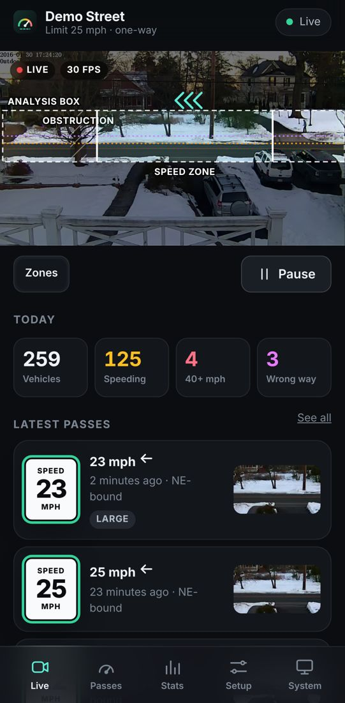
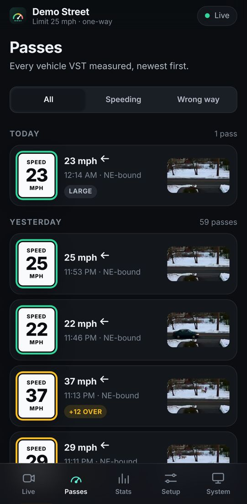
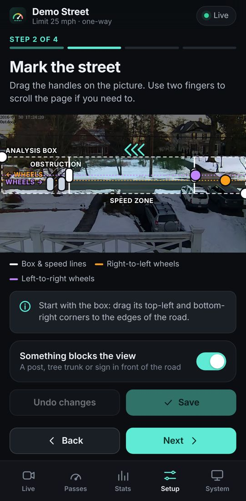
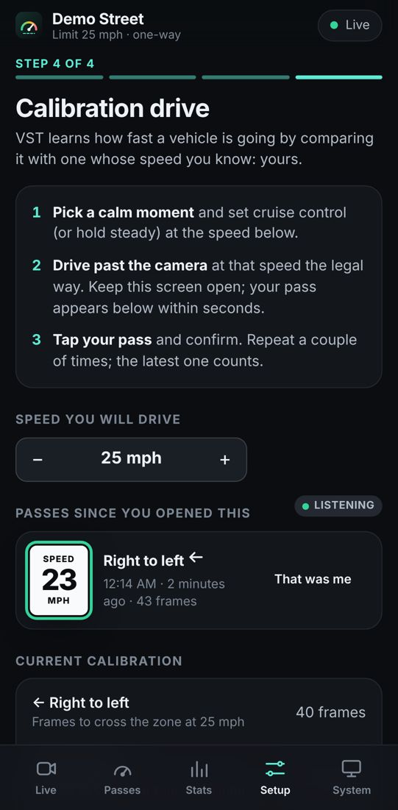
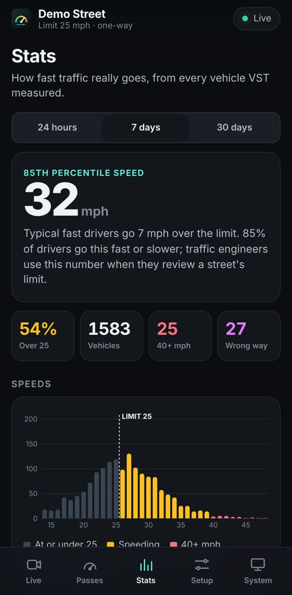
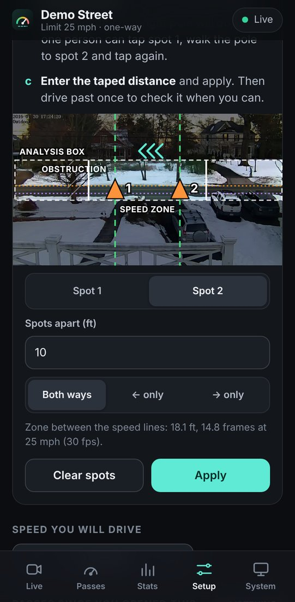
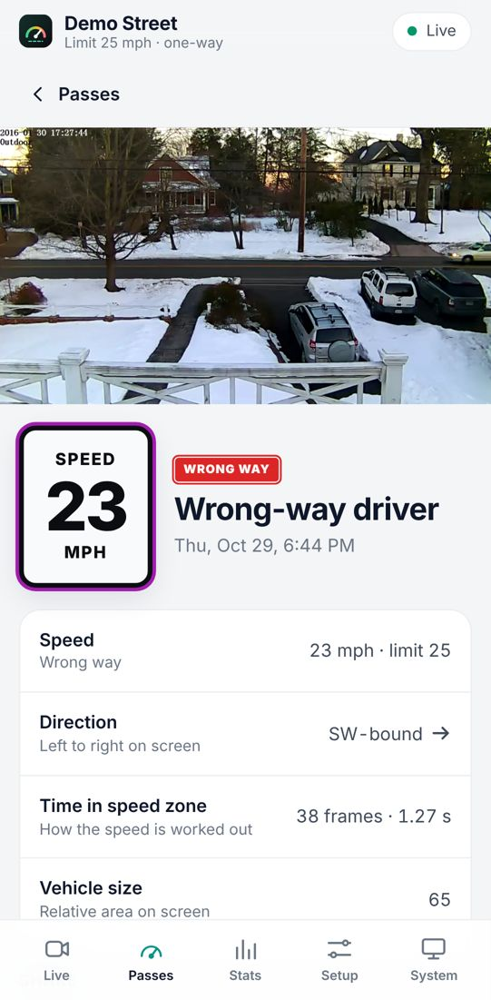
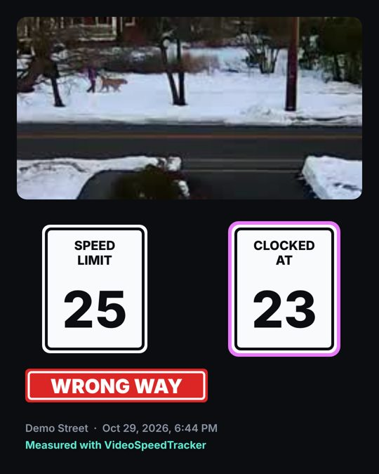
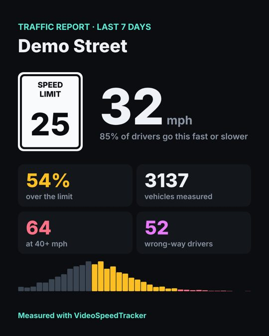

# VST Companion (experimental)

A phone app for VideoSpeedTracker. Point your phone at the QR code in VST Studio and you can:

* **Watch live**: the camera with the speed zone drawn on top, each vehicle's speed as it crosses, and today's counts.
* **See every pass**: speeders and wrong-way drivers called out, with a snapshot and a short clip of each.
* **Set up and calibrate from the street**: a four-step guide (point the camera, mark the street, set the rules,
  do a calibration drive, then a second drive that checks it) that you can follow while standing at the window or
  sitting in the car. No car handy? Chalk two spots a taped distance apart in the lane, stand a cone on each or
  walk one pole between them, and tap them on the live picture from the street.
* **Bring numbers to the meeting**: the 85th percentile speed, the share over the limit, speeds by time of day,
  and a one-tap report card image.
* **Share, if you choose**: sharing is off until you turn it on, and then only goes through your phone's own share sheet.

| Live | Passes | Mark the street | Calibration drive | Stats |
|---|---|---|---|---|
|  |  |  |  |  |

| Cones or pole (no car) | A pass | Shared card | Report card |
|---|---|---|---|
|  |  |  |  |

## Using it

1. In VST Studio on the computer with the camera, open **Companion app** (left sidebar, under Share) and turn it on.
2. Scan the QR code with your phone's camera. The companion opens already paired. No camera app that reads QR codes?
   Type the address shown under the code into the phone's browser, then the pairing code shown with it.
3. Add it to your home screen (Safari: Share → Add to Home Screen; Chrome: menu → Install app).

The phone has to be on the same Wi-Fi as the computer. Nothing is sent to the internet: VST Studio serves the
app and its data over your local network, and the phone keeps its pairing code and preferences to itself.

Want to look before you set anything up? Open the companion and tap **Explore the demo**: simulated traffic on a
one-way street, with video from the original 2016 VST recording.

### Away from home

The API is plain HTTP on the local network on purpose. To check in from elsewhere, put the computer and phone on a
private network such as [Tailscale](https://tailscale.com); `tailscale serve` also gives the companion an https
address, which lets the browser cache it for offline start-up.

## VST Ride-along (`ride/`)

A separate one-page app for calibration drives: it records the phone's GPS (time, position, GPS speed, accuracy)
while you drive past the camera and saves it as a CSV that VST Studio reads on the Calibrate page, alone or with a
Tesla dashcam clip of the same drive. Browsers only give GPS to https pages, so it doesn't run from VST Studio's
plain-http server: `.github/workflows/pages.yml` publishes just this folder on GitHub Pages, and it works offline
once added to the home screen. It never talks to VST; the file is the hand-off.

## How it's built

Static HTML, CSS and JavaScript modules: no build step, no framework, no third-party code, so VST Studio can serve
the folder as-is and it works on a network with no internet.

| File | What it does |
|---|---|
| `index.html`, `css/app.css` | App shell and the whole design system (dark first, light theme from the same tokens) |
| `js/app.js` | Pairing from the QR link, connection state, hash routing, app-wide toasts |
| `js/api.js` | Client for the [companion API](../docs/companion-api.md): live HTTP, or the demo |
| `js/demo.js` | A simulated VST that implements the same API, used by demo mode and the mock server |
| `js/overlay.js` | Draws and edits VST's zones over a 1280x720 frame |
| `js/touch.js` | Touch editing on the picture: pinch/double-tap zoom, offset drags with a loupe, hold-to-repeat nudge arrows, and the car-length ruler for sizing the street from a parked or passing car |
| `js/share.js` | Opt-in sharing: pass and report cards drawn on a canvas, Web Share with download fallback |
| `js/views/*.js` | One module per screen |
| `sw.js`, `manifest.webmanifest`, `icons/` | Installable PWA; offline shell when served over https or localhost |
| `dev/mock-vst.mjs` | Mock VST server for development |

### Developing without a camera

```sh
node companion/dev/mock-vst.mjs            # Node 18+, no npm install
```

It prints a pairing URL such as `http://192.168.1.20:8787/#token=devtoken`; open it on your phone, or in a desktop
browser with device emulation. The mock implements the whole API (auth, SSE live events, MJPEG, config validation,
calibration), so it is also the reference for checking VST Studio's implementation.

### Tests

```sh
node --test companion/test/*.test.mjs      # Node 20+, no npm install
```

`test/helpers.test.mjs` covers the pure helpers (HTML escaping, stats maths, zone geometry, address parsing).
`test/contract.test.mjs` checks [the API contract](../docs/companion-api.md) over HTTP against the mock, which it
starts itself, or against a running VST Studio with `BASE=http://<ip>:8787 TOKEN=<pairing code>` (read-only unless
`MUTATE=1`). `ctest` runs it against a real VST Studio too, as part of `tests/api_smoke.sh`.

### Packaging

`cmake --install` copies this folder (minus `dev/`, `test/` and this README) next to the program: `companion/` beside the
executable on Windows and macOS, `share/videospeedtracker/companion/` on Linux.
