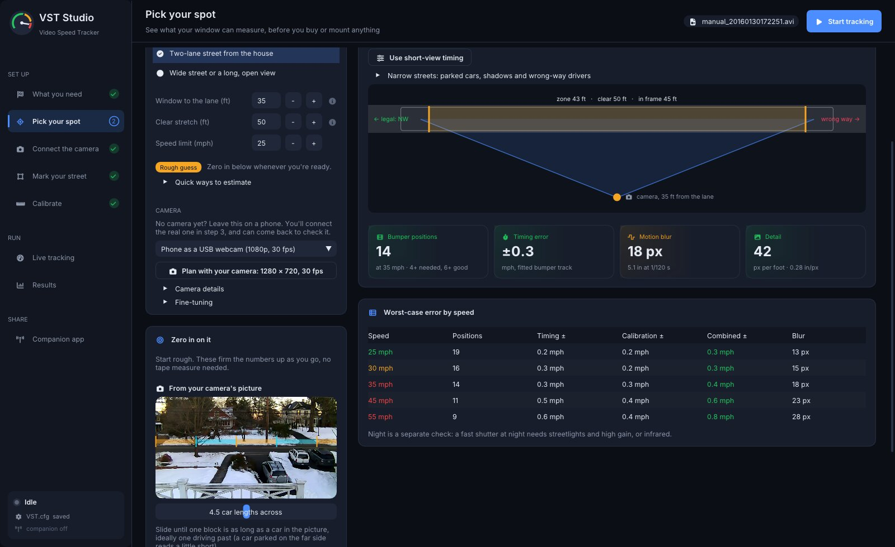
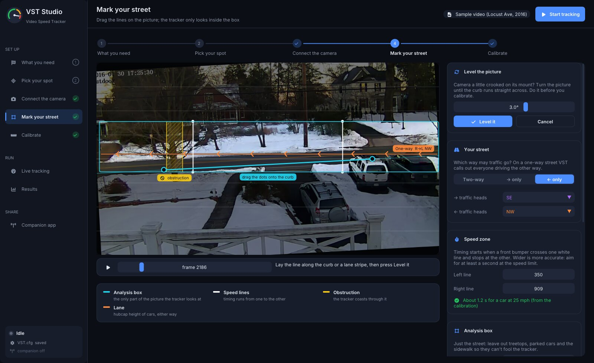
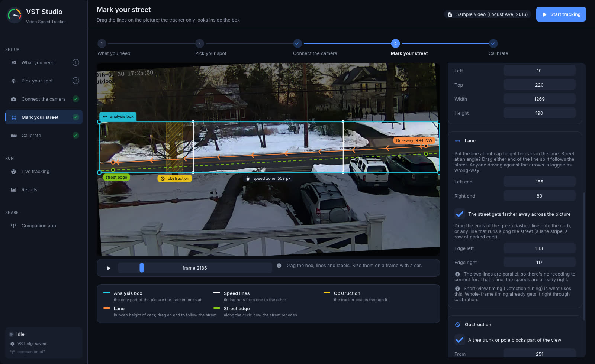
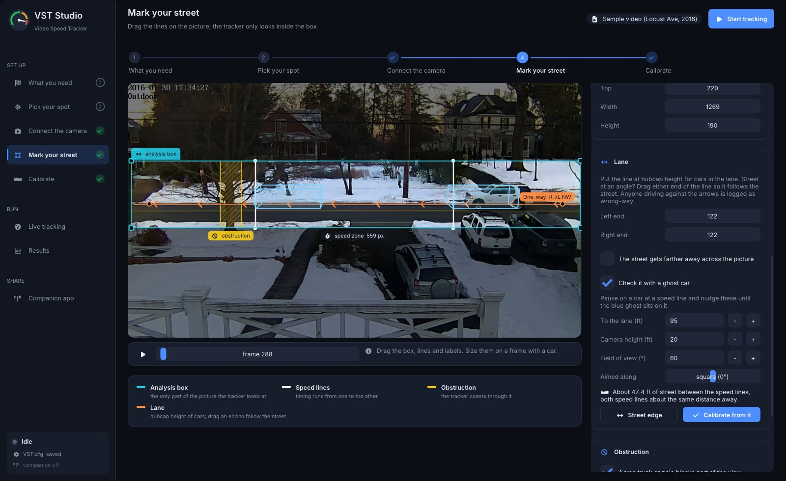
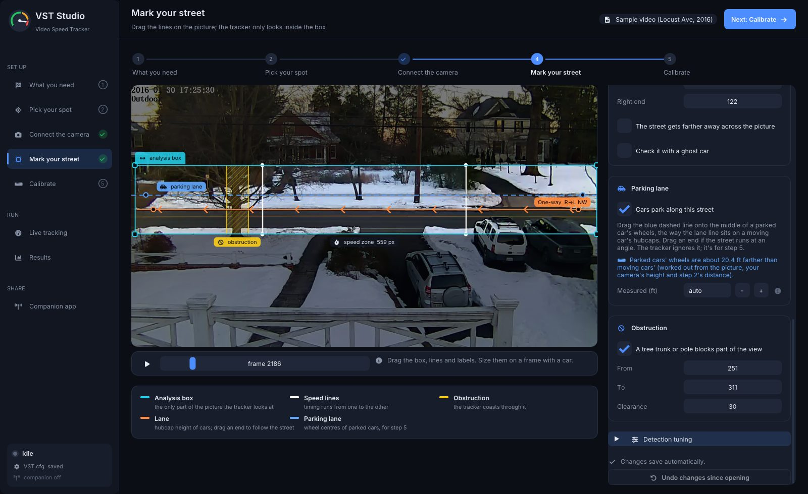
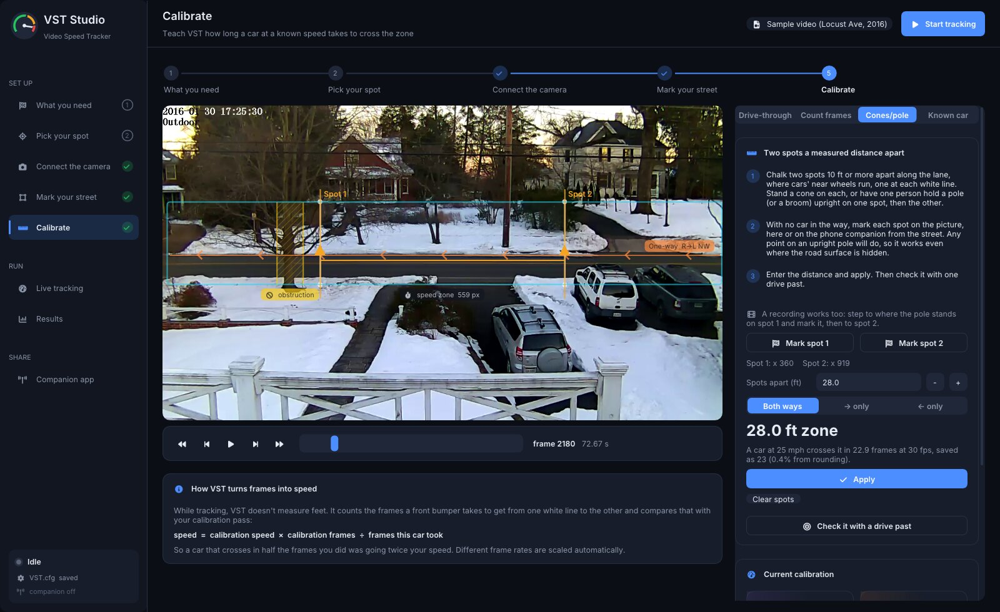
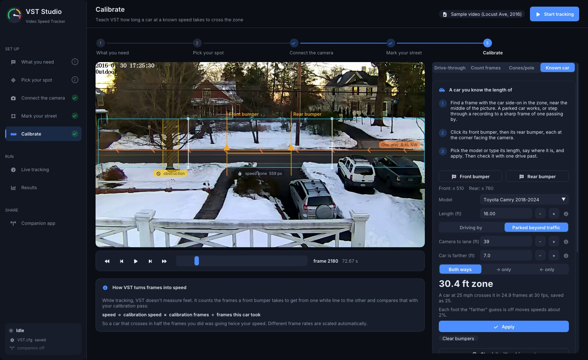

# VST Studio

VST Studio is the desktop app for VideoSpeedTracker. It runs the same tracker as the `VideoSpeedTracker` command
line, and replaces hand-editing `VST.cfg` with a guided setup: plan the camera position, draw the zones on the
picture, calibrate with one drive past and check it with a second, then watch vehicles get measured and review the speeders and wrong-way
drivers. It ships in every release package next to the command-line tools (`VSTStudio`, or **VST Studio** in
the Windows Start menu and the Linux applications menu).


The screenshots use the bundled 2016 Locust Avenue sample, which is a two-way street. To show the wrong-way
callouts, the screenshot tour treats it as one-way (right to left), so the "wrong-way" vehicles in these images
are legal drivers going the other way.

## Pages

The side rail follows the order a first-time user works in. Every page reads and writes the same `VST.cfg` the
command line uses, so a setup made here works for headless and cron runs too.

Setup is one flow of five numbered steps: **1 What you need, 2 Pick your spot, 3 Connect the camera, 4 Mark your
street, 5 Calibrate**. The side rail lists them with those numbers and names, and every setup page has the same
steps as a stepper across the top; click either to jump to a step. The header's main button walks the flow by name
(**Next: Mark your street**) until steps 3 to 5 are done, then becomes **Start tracking**. Off the flow, on Live
tracking or Results, it leads to the first step a run can't do without.

A step gets a check mark once it's done for the source and settings in use: steps 1 and 2 once you've moved past
them, Connect the camera once a source is open, Mark your street once you've checked it on the current source with
nothing for the tracker to reject, and Calibrate once a calibration was applied to this `VST.cfg` (the bundled
sample comes calibrated). A **Not calibrated** chip in the header opens step 5.

Reopening VST Studio picks up where you left off: it opens on the page you were on and reconnects the source you
last used, a USB or Pi camera included (in the background, so a missing camera never holds up the window). Steps 3
and 4 keep their checks while the camera reconnects or is unplugged; the header names it ("Camera 0 · not
connected") and a note says your setup and results are safe and how to reconnect it. **Disconnect** on Connect the
camera is the way to make Studio forget a source.

### 1 What you need

What each later step will need, one card per step in order: a window on the street (step 2), a camera held still
(step 3), a few minutes with the picture (step 4) and one drive past (step 5). **What makes a good setup** gathers
the placement tips: any mount that holds still (a stack of books counts; VST notices if the view moves), the lens
pressed to the glass with the insect screen out and a dark hood against reflections, a locked 30 or 60 fps with a
fast shutter, and daylight first. Starting with whatever camera you own is fine; the card names the upgrades that
time faster cars on a short view (a 60 fps webcam, or a Raspberry Pi 5 with the Global Shutter Camera).


### 2 Pick your spot

A site planner, for before anything is bought or mounted. Start with the street as you see it from the window,
roughly: pick the closest of **Narrow street from a front window** (20 ft to the lane, 20 ft clear), **Two-lane
street from the house** (35 / 50 ft) or **Wide street or a long, open view** (50 / 90 ft), or type the distance to
the moving lane and how long a stretch of it is clear, in feet, and set the speed limit. *Quick ways to estimate*
has tricks for doing it without a tape (paces, sidewalk slabs, a parked car, a map's measure tool). A label under
the numbers says where they came from: **Rough guess**, **Your numbers**, **From your picture**, **From the map** or
**Measured**.

**Nothing changes until you save.** Every change on this page (and from the phone, which edits the same plan) is a
preview: the bar at the top says **Preview: N unsaved changes** (hover it for the list), the verdict shows the saved
plan's beside the preview's, and the step's dot on the left rail turns amber. **Save changes** keeps them,
**Discard** puts the saved plan back. Leaving the page keeps the preview, and so does closing VST Studio. Turn on
**Save automatically** (off by default) to save each change as it is made. Short-view timing, and the one-way,
compass and site name the map finds, are applied to your settings only when you save.

**Find it on the map** opens a map of OpenStreetMap in your web browser (the phone has it too, under Pick your spot).
Search for your address, drop pin 1 on the window and pin 2 in the middle of the lane in front of it, and **Send to
Pick your spot**: the distance between the pins becomes the plan's, and the street under pin 2 gives its name, whether
it is one-way (and so which way is legal in the picture), its posted limit and the compass headings of cars crossing
the picture. The search and the map pictures come from OpenStreetMap's servers; the pins only go to your VST.

**Zero in on it** firms the guess up as setup goes on, so nobody has to measure anything on day one:

- **From your camera's picture.** Once a camera (or a video or photo of your own view) is open, the card shows it with
  a ruler of car-length blocks across the lane. Drag the stripes sideways or up and down onto a parked car (or use
  **Slide sideways**), scroll or use **Size** until one block is as long as the car, then **Use it**: that many
  15.5 ft car lengths is the width of street the picture spans, which sets the plan.
- **From your calibration.** Any calibration in step 5 (a drive past, VST Ride-along, a Tesla clip, a car of a known
  model, cones or a pole) knows the speed zone in feet, and the speed lines say how many pixels that is, so it
  measures the whole picture. Step 2 updates by itself after each new calibration (a toast says so), and a number
  typed afterwards stays until the next one. On a one-way street the legal direction's lane is used; on a two-way
  street, the mean of the two. When the distance to the lane came from you (typed, the map, or **To the lane** on
  the ghost car in step 4), a calibration keeps it and works out your lens's field of view from the measured picture
  instead, and measured numbers always replace an unsaved preview's guesses. Going back to this page never resets them: presets
  and edits here are only a preview until **Save changes**.

With a camera connected, **Plan with your camera** copies its real size and frame rate into the plan. A camera
below 24 fps gets a note saying how fast a car the planned view still times and how to raise it (most webcams and
phone apps drop to 15 fps in dim light or on "auto"); the frame-rate check on Connect the camera says the same.
The phone companion's Setup step 2 has the same card (`GET/PUT /api/plan`, docs/companion-api.md). The camera
starts as a phone; pick another from the list once you know which one you'll use, and open **Camera details** for
field of view, resolution, frame rate and shutter. It shows a to-scale top view and works out the usable timing
zone, the frames a car spends in it, the timing and calibration error, and motion blur, with a verdict and a table of
worst-case error by speed. The model:

- lane in frame = 2 × distance × tan(field of view / 2), limited by the clear stretch
- timing zone = visible lane − one car length − 0.2 s of run-up for the tracker to lock on
- timing error ≈ speed ÷ frames in the zone (a one-frame slip); in a short view, the error of a line fitted
  through the bumper positions
- calibration error = the timing error of the calibration drive (at the speed limit), as a share of every speed
- blur = speed × shutter time, in pixels at the lane

**Short views.** A narrow street seen from a front window may show only 14 to 25 ft of the lane, too
little for a car to spend 15 whole frames in the zone. The planner then calls it a short view and offers **Use
short-view timing**, which turns on `subFrameTiming` and sets the tracker's look-ahead, entry look-back and speed
lines from the plan. With it, VST fits a line through each car's front-bumper positions and times the crossing to a
fraction of a frame, so the zone no longer has to hold a whole car. **Narrow street from a front window** fills in a
typical plan, and *Narrow streets: parked cars, shadows and wrong-way drivers* has tips for that kind of view. At
30 fps a 15 ft view times cars up to about 45 mph and a 20 ft view up to about 60; at 60 fps both time cars over
70 mph, and the planner says which for your view. About 14 ft is the shortest view it plans for. For a short view
use 60 fps, a fixed shutter of 1/1000 s (1/500 at most), and a lens that frames just the clear stretch.




### 3 Connect the camera

Open recorded video (several files run as a batch), a USB camera or a phone in USB webcam mode, a Raspberry Pi
camera, or a network camera's RTSP/HTTP URL. On a Raspberry Pi with a ribbon-cable camera attached, the camera card's
menu starts on it (for example "Pi camera 0: Global Shutter Camera"), and the sliders button beside it sets the frame
rate (60 fps by default), the shutter (1/1000 s, so cars don't smear), Camera Module 3's locked focus distance, and
upside-down mounting. If the Pi finds no camera, the menu says to reseat the ribbon cable. A photo of the view also works for planning zones before the camera is installed. The
preview lists resolution, frame rate, length and codec, with plain-language checks against what the tracker
needs. Without a camera, **Use the sample** opens the 2016 Locust Avenue clip. **Aim it like this** shows where
to point the camera and how to keep it still.

Cameras and streams connect in the background, so the window never waits on one: the preview says
**Connecting to …** with a **Cancel** button, and a camera that can't be opened, a stream that doesn't answer
(5 s), or a picture that stops says why and clears. Once connected, **Disconnect** (or **Close** for a video) under
the preview, or on the camera card for the camera in use, lets go of it. The header and preview always name what
is showing, and the bundled clip is labelled **Sample video (Locust Ave, 2016)**.


The command line takes the same sources: `--input 0` opens the first camera, `--input picam` the Raspberry Pi camera
(README, [Raspberry Pi camera](../README.md#raspberry-pi-camera)), and `--input rtsp://...` a stream.

### 4 Mark your street

Drag everything on the picture: the analysis box (edges, corners, or the tab to move it), the two white speed
lines, the lane lines at hubcap height, and the obstruction band for a tree or pole. The inspector shows the
same values as numbers, explains each one, and lists anything the tracker would reject.

Settings save themselves: a change is written to `VST.cfg` a moment after you let go of a handle or field, and
never while the tracker would reject it. The first save of a session keeps the file as it was in `VST.cfg.bak`,
and **Undo changes since opening** (or **Undo** on the Connect the camera page) puts it back. Saves go to a temporary file
that replaces `VST.cfg` in one step, so a crash or power cut can't leave it half written.

**Your street** sets the compass direction of each lane and whether the street is one-way. On a one-way street
VST flags every vehicle going the other way: the lane on the picture turns red, the run shows an alert, and the
results count wrong-way drivers. This is the `LegalDirection` key in `VST.cfg` (`Both`, `L2R`, `R2L`, or the
compass label of one direction, such as `NE`); the command line prints a `WRONG WAY` line for each. A one-way
street has a single lane, so the picture shows one lane line with chevrons pointing the legal way, and dragging it
sets both `L2RStreetY` and `R2LStreetY` (a wrong-way car drives in the same lane).

**Level the picture** is for a camera that isn't mounted quite level. Cars are tracked along a lane line that runs
straight across the picture, so if the camera is rolled a few degrees, cars drift off it from one side to the other.
Drag the slider while the reference rows are on the picture, or press **Use the curb**, drag the two dots onto
the curb, a lane stripe or the bottom of a fence, and press **Level it**. The tracker then turns
every frame the same way before it looks at it (`levelDegrees` in `VST.cfg`, up to 15° either way; positive turns
the picture counter-clockwise), and the preview shows the turned picture so the lines you draw land on the same
pixels. Level first, then mark the lines and calibrate: a new angle moves the street under them. A tilt past 15° is
better fixed at the mount.

**A street at an angle.** A window that doesn't face the street squarely sees it run at a slant and get smaller
toward the far end. Levelling isn't the fix there (it would tip the cars over); instead drag either end of the lane
line so it follows the street (`R2LStreetYRight` / `L2RStreetYRight`). Each direction's cars are looked for only
above its lane line, so a line that follows the street keeps whole cars in and the sidewalk out at both ends. The
grips at the ends of the line are what to drag; an end within 2 pixels of level snaps level.

Timing between the white lines needs nothing more: calibration timed a car between the same two lines in the same
view, so the slant and the perspective are already in it. Short-view timing is the exception. It fits a straight
line to the front bumper's position frame by frame, and on a street that recedes, a car at a steady speed moves
more pixels per frame at the near end than at the far. Tick **The street gets farther away across the picture**
and lay the green dashed street edge along the curb (or a lane stripe, or the tops of a row of parked cars). Where
it closes in on the lane line is the street's vanishing point; VST then measures each car along the ground, and the
card says how much farther away one speed line is than the other. Left parallel to the lane line it changes
nothing. On the 2016 sample's 20 ft short view, warped so the street recedes (the far speed line 1.5 times as far
away as the near one), short-view timing without it timed 37 of 61 cars, up to 6 mph off and 1.4 mph fast on
average; with it, 57, nine in ten within 1 mph and none more than 2 off. With a gentle recede (1.2 times) it made
no real difference, which is why it stays off unless you need it.

**Check it with a ghost car.** Instead of measuring, you can describe how the camera sits and let Studio work out
the rest. Tick **Check it with a ghost car** on the Lane card and fill in the distance to the lane and the lens's
field of view (the same numbers as step 2), the camera's height above the road, and which way it's aimed along the
street (square, or so many degrees with the left or right end farther away). Studio draws a typical 15½ ft car in
blue at each white line, with its front bumper on the line and its hubcap on the lane line. Pause on a frame where a
real car is at one of the lines and nudge the numbers until the ghost sits on it. If the ghost is too big or too
small, the distance or lens is off; if it leans the wrong way, the angle is. Once it fits, the card says how many
feet of street lie between the white lines. **Calibrate from it** sets both directions from that length, and
**Street edge** draws the green street edge for an angled camera, so neither needs a curb or a test drive. One drive
past afterwards still checks it. On the 2016 sample, 95 ft away, 20 ft up and a 60° lens put the ghost on a passing
car and give 47 ft between the lines; the sample's own calibration drive works out to 43 to 49 ft.

**Parking lane.** If cars park along the street, tick **Cars park along this street** on the Parking lane card and
drag the blue dashed line onto the middle of a parked car's wheels, the way the lane line sits on a moving car's
hubcaps (drag an end if the street runs at an angle). The tracker ignores it. It is for step 5's **Known car**: it
lets Studio tell a parked car from a passing one by itself, and tells it how much farther away (or nearer) the
parked cars are. The card works that out from the gap between the two lines, the camera's height and step 2's
distance (the same camera model as the ghost car), or you can type a measured distance across the street, from a
passing car's wheels to a parked car's. The line is Studio's own setting (`vst-studio.ini` `parkY0`, `parkY1`,
`parkFt`), not a `VST.cfg` key.










### 5 Calibrate

VST counts frames rather than measuring distance, so it needs one pass at a known speed, or a measured distance it
can turn into one: cones a taped distance apart, or a car whose model you know.

- **Drive-through:** pick a target speed (chips for 10, 15, 20 and 25 mph and your posted limit, which is the
  default; type any other speed under **I drove at**), run tracking, drive past at that speed, pick your pass from
  the list and enter the speed you drove. Any steady speed calibrates equally well, and a slow pass is counted in more
  frames (each one-frame miss is a smaller share), so there's no need to drive faster than your street is comfortable
  with. Passes slower than **Slowest logged** (5 mph under the posted limit, at most 18, unless you set it yourself)
  aren't written to the csv or Results, but they are
  listed here, marked "slow", so a 10 or 15 mph drive can still be picked. Most cruise control won't hold under
  25 mph; hold it steady by eye, or let VST Ride-along read the speed (below). **Check it with a second drive**
  suggests a speed 5 mph away from the first. From the Results page, **This was me** on a selected vehicle does the
  same.
- **Count frames:** step through a calibration video (←/→, Shift for 10 frames, Space to play), mark the frame
  where the front bumper touches each line, and enter the speed.
- **Cones or pole:** no car needed. Chalk two spots a taped distance apart along the lane (10 ft or more), stand
  a cone on each or hold a pole (a range pole, a broom, PVC pipe with tape bands) upright on one and then the other,
  click each on the picture and enter the distance. Only the left-right position counts, so any point on an upright
  pole will do, even where a porch roof or parked car hides the road surface, and one person can do it with one pole.
  VST works out how long the speed zone is (zone width ÷ spot spacing on the picture × feet) and the frames a car at
  `CalibrationSpeed` takes over it (`feet ÷ (CalibrationSpeed × 5280 / 3600) × CalibrationFPS`), for both directions
  or just one. It is only as good as the spots' depth: put them on the line the cars' near side runs along, because
  the far lane crosses more road between the lines. The page shows the zone length and how much rounding to whole
  frames costs; this calibration is marked **Not checked** until a drive past checks it. Put one spot at each white
  line if you can: spots closer together still work, but the zone length is scaled up from them, so any marking
  error grows with it, and with the camera at an angle to the street the same stretch of road doesn't cover the same
  pixels everywhere across the picture. Below about 60% of the zone the page says so.

  The phone companion has the same step (Setup › 5 Calibrate › *No car handy?*), so you can stand on the
  street with the phone on your Wi-Fi, see yourself and the pole on the live picture, tap it and apply there.

  On your own, or with the phone busy being the camera, **Take two timed pictures**: press it, walk out, and hold
  the pole on spot 1 for the first picture (30 s later) and on spot 2 for the second (20 s after that). A countdown on
  the picture says which is next. Back at the computer, click the pole in each picture. With a recorded video instead
  of a live camera, step to where the pole stands on each spot and mark it there.



- **Known car:** no tape and no trip outside. Any car of a known model in the picture is the measuring stick: find a
  frame with it side-on in the zone, near the middle of the picture, click the **centre of each wheel** on the side
  facing the camera, and pick the model (the list gives each generation's wheelbase) or type the wheelbase. The
  arithmetic is the cones' with the wheels as the two spots.

  Why wheel centres: a wheel's middle is a sharp point at the same height as the lane line (which sits on moving cars'
  hubcaps), so it's easy to click, and a car a little off square to the camera, rounded corners, a tow hitch or a bike
  rack don't change it. A bumper's "corner" is fuzzy, and off to one side the camera also sees part of the nose or
  tail, which looks like extra length. **Bumpers** is still there for a car whose wheels are hidden (by snow, a
  parked car in front): click the front and rear bumpers at the corners facing the camera, with the model's overall
  length.

  Where the car is matters. Things look smaller the farther they are from the camera, and VST times bumpers in the
  lane traffic drives in, so a car parked beyond that lane looks shorter than it would driving by and every speed
  would read high. With a parking lane drawn in step 4, Studio says on the picture which line the wheels are on:
  **PARKED · scaled ×N to the travel lane** in blue, **IN THE TRAVEL LANE** in the lane's colour, or **Not on a
  line** when the clicks are well away from both (usually not the wheel centres). A parked car's span is scaled to
  the travel lane with the same camera model as the ghost car: how much a foot of street shrinks between the parked
  cars' depth and the lane's at that spot in the picture. For a camera up at a window that is noticeably less than
  the plain ratio of distances, so it is worked out rather than guessed. You can override parked or in the lane.
  Without a parking lane, choose **Parked** and type how much farther the car is than moving cars (negative for
  nearer); the page links to step 4 to draw one instead. A car driving by needs no correction: step through a
  recording to a sharp frame of it. On a two-way street, **Both ways** calibrates each direction from its own lane.

  How it compares with cones: a tape over 10 ft or more is good to well under 1%, and the cones stand right at the
  white lines and the depth the bumpers run at. A model's wheelbase is good to about 0.5% once the generation is right,
  but the car usually spans less than the zone and a parked car needs the depth correction. Expect a few percent
  (about 1 mph at 25 mph) from a passing car or a corrected parked one, which makes it a good start; like the cones it
  is **Not checked** until a drive past checks it.



All four keep the other direction's calibration valid by expressing it against the same `CalibrationSpeed` and
`CalibrationFPS`. The page shows what crossing times read as which speeds.

#### Your calibration: every way adds up

The ways to calibrate complement each other instead of replacing each other. Each one (a drive past, a Ride-along or
Tesla pass, **This was me**, cones or a pole, a known car, the Lane card's camera setup) is kept as a *measurement*,
and the calibration in force is their combination. Adding one never wipes out another, and any one can be taken out
and put back.

Every method ends up saying the same thing: how many feet of street lie between the two speed lines. A pass at
`v` mph taking `n` frames at `f` fps says `v × 5280/3600 × n / f` feet; two spots `D` feet apart, `p` pixels apart
on the picture, say `(speedLineRight - speedLineLeft) / p × D`. Each also carries how sure it is (a relative
uncertainty, worked out from its own numbers):

| Method | Uncertainty |
|---|---|
| Drive past at `v` mph over `n` frames | speedometer about 2% plus 0.5 mph, and ±0.41 frame of counting whole frames: `hypot(hypot(0.02 v, 0.5) / v, 0.41 / n)`, about 4% for 15 mph over 20 frames |
| Cones or pole `p` px apart | 1% for the tape, 4 px of clicking over the span, 2.5% for where the spots sit: `sqrt(0.01² + (4/p)² + 0.025²)`, about 3% |
| Known car `p` px long | 0.5% for the model's length, 4 px of clicking, 2% for the corners; parked beyond traffic, plus 1.5 ft of the "farther" guess over the distance to the car |
| Camera setup (ghost car) | 10%: typed distance, height, angle and lens |
| A calibration made before this list was kept | 6% (method not on record) |

VST combines them by inverse-variance weighting: each counts with weight `1 / uncertainty²`, so a careful drive past
has far more say than a rough camera setup, and two equally good ones are simply averaged. The combined uncertainty is
`1 / sqrt(Σ weights)`, widened when the measurements disagree by more than their own uncertainties allow (by the
Birge ratio `sqrt(χ² / (n - 1))`), so two careful methods 10% apart never claim ±1%. `CalibrationFrames` is the
combined length's frames at `CalibrationSpeed` and `CalibrationFPS`, rounded.

Under the picture, **What your calibration is made of** lists each measurement with its share of the weight and how
far it sits from the result, and the **Your calibration** card says in one line how they stand:

- **1 measurement so far**: add another way and VST cross-checks them.
- **3 measurements agree within 2%**: the range of them, highest to lowest, as a share of the result.
- **2 measurements differ by 9%**: VST uses the weighted middle; a third measurement will show which is off.
- **3 measurements, 1 well off the others**: with three or more, one that sits more than 3 sigma and 4% off the rest,
  while the rest agree, is marked. It still counts until you take it out with its ✕.

Each line also says how good the result is in mph at your limit ("Good to about ±2.0%, so ±0.3 mph at 15 mph").
Taken-out measurements stay under **Not counted** with **Put back**. A measurement only counts on the speed lines it
was made with: moving a line or resizing the box sets them aside (listed as "other speed lines"), the same way it
made the single calibration stale before. The same pass added twice counts once.

A measurement that agrees to the frame leaves `CalibrationFrames` as it was, and with it any check of that value;
one that changes it is a new calibration, which needs a new check. Measurements are kept in
`calibration-inputs.json` in the config folder, one list per `VST.cfg`. The first time a calibrated `VST.cfg` is opened
without one, its calibration becomes the first measurement: the drive past it came from, when the history shows one,
or **Your earlier calibration**.

The phone companion's step 5 shows the same summary and list, with **Take out** and **Put back**.


#### Calibrating without cruise control: Tesla dashcam and phone ride-along

You can drive past at any steady speed and let a recording supply the speed, instead of holding cruise control:

- **A Tesla's dashcam.** Teslas on software 2025.44.25 or later (HW3 and newer) record the car's speed in every
  dashcam frame. Use the `-front.mp4` clip for that minute from the USB drive's `TeslaCam` folder.
- **Any phone, with VST Ride-along.** Open [joekiller.github.io/VideoSpeedTracker](https://joekiller.github.io/VideoSpeedTracker/)
  on the phone (add it to the home screen and it works with no signal), pick your target speed (it shows on target,
  too fast or too slow while you drive), tap **Start recording** before you set off,
  drive past, then **Stop** and save the `.csv` to the computer. It records the phone's GPS position and speed, which
  is good to about half a mph at a steady speed. It sends nothing anywhere.

Pick your pass and press **Read my speed from a dashcam clip or ride-along**; choose the files. Load both a Tesla
clip and a ride-along for the same drive and VST Studio cross-checks them: two independent speedometers within
1.5 mph of each other are averaged, and if they disagree it says so and uses the Tesla's wheel speed. Either way
it fills in the speed to a tenth of a mph and warns if the car sped up or slowed down in the zone. The files stay
on your computer.

The first match is by time, which needs the computer's clock and the car's or phone's to agree within a second or
two (all of them normally set themselves from the internet or GPS). Once a pass is matched and steady, **Remember
this spot for GPS matching** saves where the car was halfway through the zone; you can also paste the spot from a
map app. After that, passes are matched by the moment the GPS went by that spot, so the clocks no longer matter:
they only pick which drive-by it was when a recording holds more than one. The page says how each was matched.

#### Check it with a second drive

A single pass at a speedometer reading is easy to get wrong, and it's the first thing a traffic engineer will ask
about. Once a direction is calibrated, **Check it with a second drive** tests it with an independent pass:

1. Drive past again, ideally at a different speed from the first pass (say 30 mph after calibrating at 25).
2. Pick that pass (or mark its frames in **Count frames**) and enter the speed you drove.
3. VST shows what the current calibration says the pass was beside the speed you drove, and the error.

Within ±2 mph is **Verified**. Off by more, the page lists the usual causes: a speedometer that reads high (most
do, more so at speed; a GPS speed app is a better reference), a camera or speed lines that moved since the first
pass, or the two passes being in different lanes (the far lane crosses more road between the lines). It then
offers to **Drive again**, leaving that pass out, or to **Add this pass** to the calibration as one more measurement:
with two honest passes the result lands near their mean, and with more it is one voice among several. The button
says the frames it would give. A changed calibration counts as new, so check it once more.

The **Your calibration** card shows each direction's standing under its tile: **Not calibrated**,
**Not checked**, **Verified (±0.3 mph)** or **Check failed (+4.2 mph)**. The Calibrate check mark in the side rail
still only means a calibration was applied. A check counts only while the calibration it tested is the one in
`VST.cfg`; changing the value any other way (by hand, or from the companion's settings) makes it "Not checked"
again.


#### Calibration history

Every change to the calibration and every check is appended to `calibration-history.csv` in the config folder (next
to `vst-studio.ini`), from the drive-through, **Count frames**, **Cones or pole**, **Known car**, **This was me** on the
Results page, and the phone companion. Since measurements combine, a change is recorded as an apply at
`CalibrationSpeed` and `CalibrationFPS` with the combined frames, and only when the whole-frame value changes; the
measurements behind it, with their methods, are in `calibration-inputs.json` beside it. Rows are added and never rewritten, so the file is a record you can show someone: when each calibration
was made, from what pass, and how a second pass agreed with it. The per-direction state on the page is worked out
from it, so it survives restarts.

```
Timestamp, Config, Kind, Direction, DrivenMph, Frames, Fps, CalibrationFrames, MeasuredMph, Error
2026-11-02T10:14:03-05:00, /home/joe/.config/videospeedtracker/VST.cfg, apply, L2R, 25, 34, 30, 34, ,
2026-11-02T10:21:40-05:00, /home/joe/.config/videospeedtracker/VST.cfg, check, L2R, 30, 28, 30, 34, 30.4, 0.4
```

- **Config** is the `VST.cfg` the row belongs to; one file serves every config on the computer.
- **Kind** is `apply` (set the calibration) or `check` (a verification pass). **Direction** is `L2R` or `R2L`.
- **DrivenMph**, **Frames** and **Fps** describe the pass: the speed you drove and the frames it took between the
  lines at that frame rate. **CalibrationFrames** is the value in force after the event. Rows from before
  measurements were combined record the pass itself, and an average as an `apply` of the second pass with the
  averaged value.
- **MeasuredMph** (what the calibration says the check pass was) and **Error** (MeasuredMph − DrivenMph) are set
  for checks only.

### Live tracking

Vehicles are drawn as they're tracked: a box per vehicle, a white bar on the front bumper the tracker times,
and the speed once it crosses the second line, coloured green, amber (over the limit) or red (at or above the
"way over" speed). Wrong-way vehicles are red with a warning. **Tint the motion the tracker sees** overlays the
frame difference the tracker works from. **Recordings play** at **Normal speed** (like watching the video) or
**Full speed** (as fast as the computer can analyse them). Both give the same speeds, because VST counts frames
rather than timing them; full speed only finishes a long recording sooner. A live camera or stream runs at its own
pace, so the setting is greyed out while one is the source, whatever its frame rate. Each vehicle
lands in the filmstrip with a snapshot, and the side panel keeps counts and the fastest vehicles.

Each run writes the usual outputs under the data folder: `Stats/stats_<name>.csv`, a highlights video in
`HiLites/` (if enabled), and a short clip per vehicle in `Clips/`. Every csv row has a Timestamp: when the vehicle
passed, from this computer's clock for a camera or stream (see [the stats csv](../README.md#the-stats-csv)).

A camera or stream runs until you press Stop. If the picture drops out, the badge turns to **RECONNECTING…** and the
tracker reopens the source after 1, 2, 4, 8 and 16 s, then every 30 s until it's back; Stop works during the wait.
Vehicles in the speed zone when the picture stopped are dropped rather than measured across the gap.

While a run goes on, **Pick your spot**, **Connect the camera**, **Mark your street** and **Calibrate** keep showing
its picture, with the same badge. It's the tracker's own feed passed along, not a second connection to the camera,
so switching pages costs nothing extra and never interrupts the run. The run keeps the settings it started with:
lines you drag now are saved and used the next time you start tracking. When you press Stop, the preview reconnects
to the camera by itself.

#### Leaving it running

The **Unattended health** card on this page looks after a camera left running for days or weeks:

- **Camera position.** Every 2 minutes of a live run, VST compares the picture with a reference view kept with
  the zones (`view-reference.jpg` in the config folder). It's taken from the first check after the zones or the
  source change, so redrawing the zones resets it.
  - The comparison lines up the edges of fixed things (curbs, poles, house fronts), so passing cars and the light
    changing through the day don't count.
  - If the view has shifted more than about 10 px in three checks in a row, the card and the header warn
    **Camera moved?** Re-aim the camera, redraw the zones, or press **It's fine, use this view**.
  - At night, in fog or with a covered lens there isn't enough to compare. The card says so, and that neither
    raises nor clears the warning.
- **Disk.** Clips and highlight videos are pruned to **Keep up to** (20 GB by default; 0 keeps everything), oldest
  first, every 10 minutes. If the disk falls under 2 GB free, more old video goes so the stats always have room.
  Stats csvs, run manifests, reports and the calibration history are never removed.
- **Daily log.** `Stats/health.csv` gets one row per day a live source ran: `Date, TrackedHours, OutageHours,
  Outages, Vehicles, ClipsRemoved, FreeGB, Camera`. The row is written when the day ends or VST Studio closes, so
  a restart adds a second row for the same date. It tells a quiet street apart from a camera that was offline.
  Camera is the worst check that day: `moved`, `unclear`, `same` or `unchecked`.

### Results

The menu next to the search box picks what the page shows: **This session** (vehicles measured since Studio opened,
with snapshots and clips), **All saved runs** (every run in the data folder's `Stats/`, newest first), or one saved
run. Results opens on all saved runs when this session hasn't measured anything yet, so earlier results are there
the moment Studio reopens. Filter by speeding, way over, or wrong way; see a speed histogram with the limit marked, every vehicle over
time, the 85th-percentile speed, and a sortable table. Selecting a vehicle shows its snapshot, details and clip.
The **In → out** column shows each car's speed at the first and second speed line with an icon for how it changed:
slowing down (green), steady, speeding up (amber) or rapidly speeding up (red); sort it to find the cars that floored
it. The detail card adds the acceleration and the speed 20 ft further on. How it's measured, and why a 14 ft view at
30 fps sometimes says "can't tell": [speed-trend.md](speed-trend.md).
**Open CSV** loads any stats file from an earlier run or from the command line, and shows each vehicle at the
time in its Timestamp column. Csvs from before that column existed show Date and Time instead, which for Foscam
recordings (`manual_yyyymmddhhmmss`) is when the recording started.

**Size.** With a calibration, each vehicle's length is shown in feet (a car is about 15 ft, a pickup or van 19-23, a
truck or bus 24 or more, which gets the truck icon). It is measured from the tracked boxes while the vehicle is wholly
in view (the median, so a branch or a walker caught in one box doesn't stretch it), less what frame differencing adds,
and scaled by the calibration's feet per pixel, so any calibration, a known parked car included, scales sizes too.
Each new calibration also resets VST.cfg's `largeVehicleArea` to about 190 sq ft at that scale, which is what rows
opened from an older csv (no length in it) use.

**Your own drives are marked.** A pass you used to calibrate or check (Calibrate's *Use this pass* or *Check this
pass*, or the phone's *That was me*) shows a **calibration** or **check** tag, and its details say the speed you drove.
It stays in the table but is left out of the tiles, the charts and the street report, since the person setting up
isn't traffic. The marks are kept in `calibration-passes.csv` in the config folder (the pass's stats csv and frame),
so they survive a restart.

**Runs from before your latest calibration.** Each run's manifest records the calibration it was measured with. When
that differs from the current one, its rows get an **old calibration** tag, and a line under the toolbar counts them:
*2 runs (65 vehicles) measured before your latest calibration*. **Set them aside** moves those csvs and manifests to
`Stats/Before calibration`. Nothing is deleted, and Open CSV still reads them. They drop out of Results and the street
report, which reads only `Stats/`. **Put them back** undoes it. Calibrating during a live run
(camera or stream) restarts tracking, so the cars from then on are measured with the new value in a new csv. A video
keeps the calibration it started with until you run it again.


The 85th percentile here, in the street report and on the phone all use the nearest-rank definition (see below).

### Street report

**Make report** on the Results page turns the data folder into a report a city council and a traffic engineer can
read: one HTML file that opens in any browser and prints cleanly to PDF (A4 or Letter, one section per page). It is
labelled *Community traffic study. Estimated speeds, ±X mph* throughout, where X is worked out from the setup (below).

The dialog asks for:

- **Site name**: the street and block, such as *Locust Ave, 600 block*. Never a house number. It's remembered.
- **Dates**: from and to, as `YYYY-MM-DD`; leave them blank for all the data.
- **Compare with another period**: a before/after table of the key numbers for a second date range, for example
  before and after a speed hump went in.
- **Include example frames**: off by default. Only vehicles tracked in this session have snapshots; each is shrunk
  and the lower part of the vehicle (plate height) is blurred, and nothing identifying is added.
- **Note**: a few lines for the cover.

The speed limit and "way over" speed come from the Live page. The report is saved as
`<data folder>/Reports/report_<site>_<from>_<to>.html`; **Open** shows it in the browser, ready to print.


*The first page of a report on the bundled 2016 sample: ten minutes of video, no run manifest and no calibration
history, so the report says its coverage is estimated and the calibration unverified.*

What's in it:

| Section | Contents |
|---|---|
| Cover | Site, directions, posted limit, date range, the error band, the 85th percentile, % over the limit, % at 10+ over, the fastest vehicle, wrong-way share (one-way streets), and whether the calibration is verified |
| Coverage and volumes | Hours observed per day and hour (from each run's start and end minus outages), gaps of an hour or more, vehicles logged, vehicles below the logging minimum and vehicles that couldn't be timed, and the capture rate. Counts are never scaled up to full days |
| Speeds | Count, mean, median, 85th percentile, % over, % at 10+ over and the maximum, per direction and combined; a speed histogram with the limit; vehicles per observed hour and the 85th percentile by hour of day |
| When speeding happens | % over the limit by weekday and hour, when the data covers more than one weekday |
| Wrong-way drivers | One-way streets only: count and share of traffic by hour |
| Before and after | When a comparison period was chosen |
| Calibration and accuracy | Every calibration and check pass for this `VST.cfg` from `calibration-history.csv`, the verified state of each direction, and how the error band is made up |
| Method | How VST measures, what's excluded and why, the percentile definition, limitations of this data, the files used and the VST version |

**The error band** is the sum of three parts, for the worse direction: one frame of timing at the limit (a car at the
limit crosses in N frames, so one frame is limit ÷ (N − 1)), the error of the latest check pass if there is one, and
0.5 mph because speeds are logged as whole numbers. A direction is **verified** when its latest check pass after its
latest calibration read within 2 mph and tested the `CalibrationFrames` the runs used; if `VST.cfg` was edited by hand
since, that direction is *not checked* and the check's error is left out of the band.

**Percentiles** use the nearest-rank method: sort the n speeds, and the p-th percentile is the value at position
⌈p/100 × n⌉.

**Older data still works.** Runs from before VST 1.2 have no run manifest: their observed time is taken from the
first to the last vehicle and the report says so, and the logging-minimum and untimed counts are left out. Stats
csvs from before the Timestamp column get their times from the Date and Time columns plus each vehicle's frame
number. Without a calibration history the report says the calibration is unverified. Each of these is listed under
*Limitations of this data*.

The phone companion's **Stats** view has a **Street report** button that opens the same report for the period on
screen (`GET /api/report.html`, see [companion-api.md](companion-api.md)).

### Companion app

Turning on the companion starts a small web server on the local network (port 8787) for the phone companion
app: live view with the zones drawn on, calibration from the curb, run control, and recent vehicles with
snapshots and clips. Pairing uses a random token carried in the QR code (`http://<ip>:8787/#token=...`); every
API call needs it, and **New pairing code** signs out every paired phone, closing any live view it has open.
On a computer with more than one network (Wi-Fi and Ethernet, a VPN, virtual adapters) the page offers a choice
of address for the QR code, for when the automatic one isn't on the phone's network. Up to four live views can
be open at once. The API is described in [companion-api.md](companion-api.md).


## Where things are saved

| | |
|---|---|
| Settings (`VST.cfg`) | the file shown on the Connect the camera page; by default the per-user config (see the README) |
| App preferences | `vst-studio.ini` in the same config folder: speed limit, site planner inputs and where they came from, the last source and page, recent sources, pairing token |
| Calibration history | `calibration-history.csv` in the same config folder: every calibration and check, appended (see [Calibration history](#calibration-history)) |
| Results | the data folder (`dataPathPrefix`, or the per-user data folder when blank): `Stats/` (csv and run manifests), `HiLites/`, `Clips/`, `Trace/`, and street reports in `Reports/` |

## For developers

The GUI is `src/Gui`, built by the main CMake build (turn it off with `-DVST_BUILD_GUI=OFF`). CMake fetches its
dependencies at configure time at pinned versions and links them statically: GLFW 3.4, Dear ImGui 1.91.9b,
portable-file-dialogs, cpp-httplib 0.18.3, nlohmann/json 3.11.3, Nayuki's QR code generator 1.8.0, and the
Inter and Font Awesome Free fonts (compiled in). Linux builds need the X11 and OpenGL headers
(`libgl-dev libx11-dev libxrandr-dev libxinerama-dev libxcursor-dev libxi-dev`).

The tracker is embedded, not rewritten: `videoSpeedTracker.cpp` compiled with `VST_EMBEDDED` turns `main()` into
`vst::run()` and calls the hooks in `src/Wintel64/VideoSpeedTracker/Engine.h` where the CLI would show a window,
poll the keyboard or exit. The CLI build is unchanged and the sample-video regression test still guards it.

`VSTStudio --shots DIR` drives every page on the sample video and saves a screenshot of each; CI runs it under
Xvfb (`.github/workflows/build.yml`) and uploads the images, which is how the ones on this page were made.
