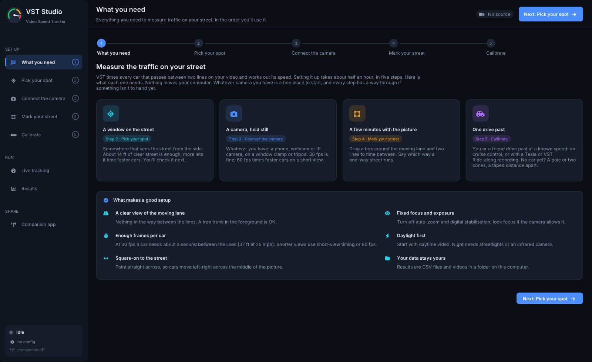
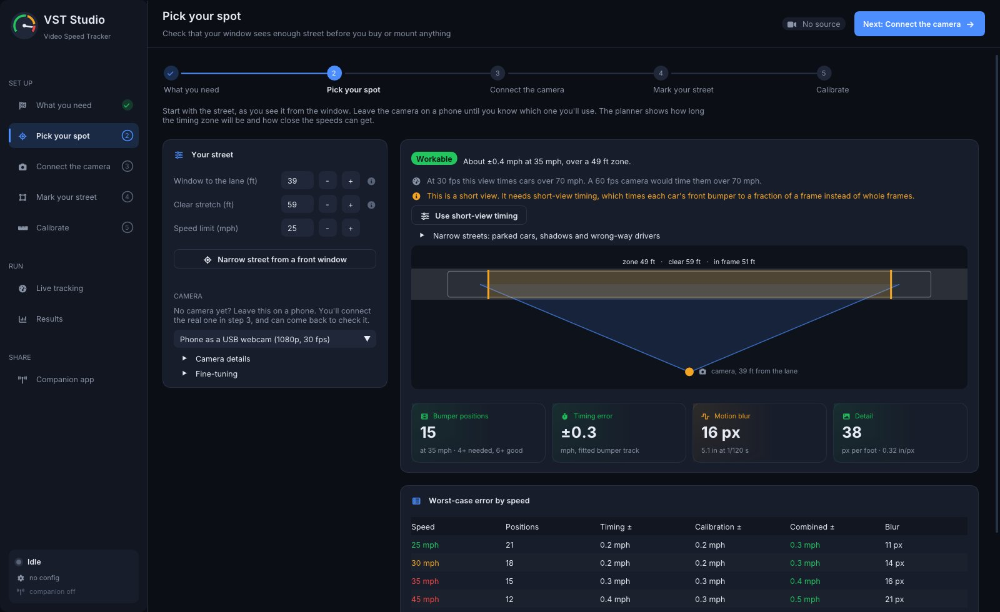
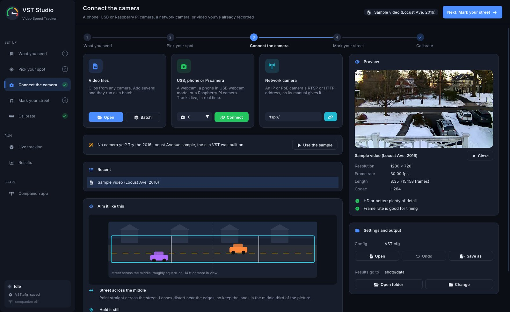
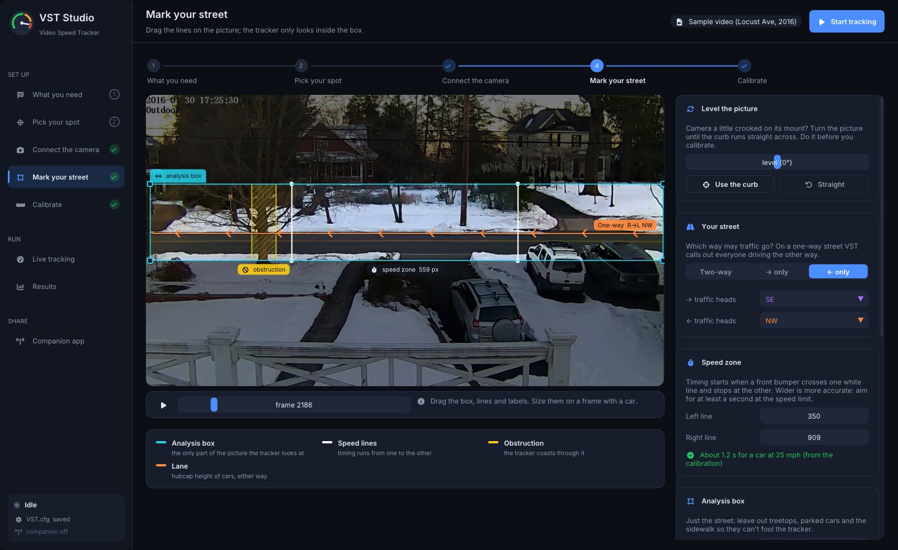
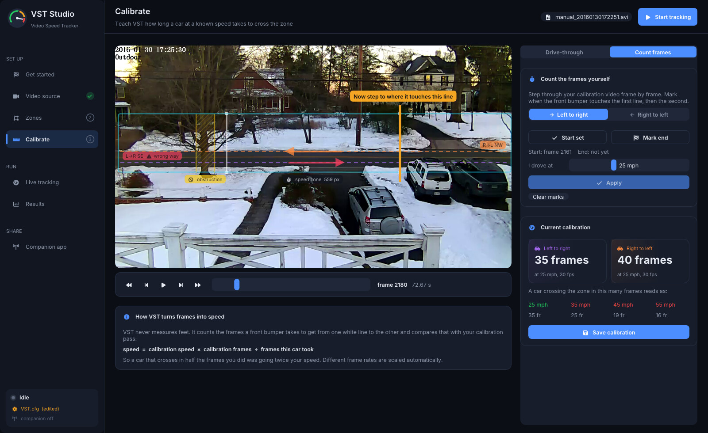
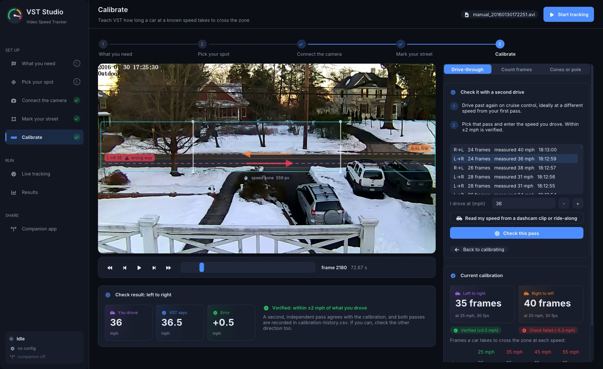
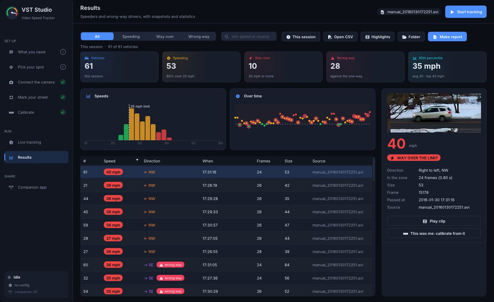
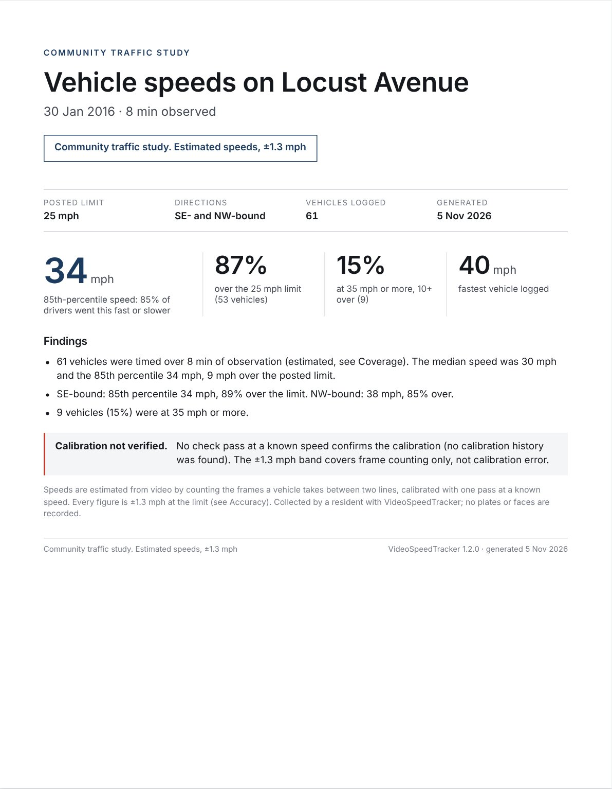
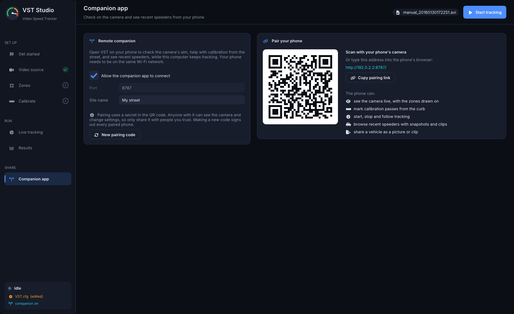

# VST Studio

VST Studio is the desktop app for VideoSpeedTracker. It runs the same tracker as the `VideoSpeedTracker` command
line, and replaces hand-editing `VST.cfg` with a guided setup: plan the camera position, draw the zones on the
picture, calibrate with one drive past and check it with a second, then watch vehicles get measured and review the speeders and wrong-way
drivers. It ships in every release package next to the command-line tools (`VSTStudio`, or **VST Studio** in
the Windows Start menu and the Linux applications menu).


The screenshots use the bundled 2016 Locust Avenue sample, which is a two-way street. To show the wrong-way
callouts, the screenshot tour treats it as one-way (right to left), so the "wrong-way" vehicles in these images
are legal drivers going the other way.

## Pages

The side rail follows the order a first-time user works in. Every page reads and writes the same `VST.cfg` the
command line uses, so a setup made here works for headless and cron runs too.

Setup is one flow of five numbered steps: **1 What you need, 2 Pick your spot, 3 Connect the camera, 4 Mark your
street, 5 Calibrate**. The side rail lists them with those numbers and names, and every setup page has the same
steps as a stepper across the top; click either to jump to a step. The header's main button walks the flow by name
(**Next: Mark your street**) until steps 3 to 5 are done, then becomes **Start tracking**. Off the flow, on Live
tracking or Results, it leads to the first step a run can't do without.

A step gets a check mark once it's done for the source and settings in use: steps 1 and 2 once you've moved past
them, Connect the camera once a source is open, Mark your street once you've checked it on the current source with
nothing for the tracker to reject, and Calibrate once a calibration was applied to this `VST.cfg` (the bundled
sample comes calibrated). A **Not calibrated** chip in the header opens step 5.

### 1 What you need

What each later step will need, one card per step in order: a window on the street (step 2), a camera held still
(step 3), a few minutes with the picture (step 4) and one drive past (step 5).



### 2 Pick your spot

A site planner, for before anything is bought or mounted. Start with the street as you see it from the window:
the distance to the moving lane and how long a stretch of it is clear, in feet, and the speed limit. The camera
starts as a phone; pick another from the list once you know which one you'll use, and open **Camera details** for
field of view, resolution, frame rate and shutter. It shows a to-scale top view and works out the usable timing
zone, the frames a car spends in it, the timing and calibration error, and motion blur, with a verdict and a table of
worst-case error by speed. The model:

- lane in frame = 2 × distance × tan(field of view / 2), limited by the clear stretch
- timing zone = visible lane − one car length − 0.2 s of run-up for the tracker to lock on
- timing error ≈ speed ÷ frames in the zone (a one-frame slip); in a short view, the error of a line fitted
  through the bumper positions
- calibration error = the timing error of the calibration drive (at the speed limit), as a share of every speed
- blur = speed × shutter time, in pixels at the lane

**Short views.** A narrow street seen from a front window may show only 14 to 25 ft of the lane, too
little for a car to spend 15 whole frames in the zone. The planner then calls it a short view and offers **Use
short-view timing**, which turns on `subFrameTiming` and sets the tracker's look-ahead, entry look-back and speed
lines from the plan. With it, VST fits a line through each car's front-bumper positions and times the crossing to a
fraction of a frame, so the zone no longer has to hold a whole car. **Narrow street from a front window** fills in a
typical plan, and *Narrow streets: parked cars, shadows and wrong-way drivers* has tips for that kind of view. At
30 fps a 15 ft view times cars up to about 45 mph and a 20 ft view up to about 60; at 60 fps both time cars over
70 mph, and the planner says which for your view. About 14 ft is the shortest view it plans for. For a short view
use 60 fps, a fixed shutter of 1/1000 s (1/500 at most), and a lens that frames just the clear stretch.



### 3 Connect the camera

Open recorded video (several files run as a batch), a USB camera or a phone in USB webcam mode, or a network
camera's RTSP/HTTP URL. A photo of the view also works for planning zones before the camera is installed. The
preview lists resolution, frame rate, length and codec, with plain-language checks against what the tracker
needs. Without a camera, **Use the sample** opens the 2016 Locust Avenue clip. **Aim it like this** shows where
to point the camera and how to keep it still.



The command line takes the same sources: `--input 0` opens the first camera and `--input rtsp://...` a stream.

### 4 Mark your street

Drag everything on the picture: the analysis box (edges, corners, or the tab to move it), the two white speed
lines, the lane lines at hubcap height, and the obstruction band for a tree or pole. The inspector shows the
same values as numbers, explains each one, and lists anything the tracker would reject.

Settings save themselves: a change is written to `VST.cfg` a moment after you let go of a handle or field, and
never while the tracker would reject it. The first save of a session keeps the file as it was in `VST.cfg.bak`,
and **Undo changes since opening** (or **Undo** on the Connect the camera page) puts it back. Saves go to a temporary file
that replaces `VST.cfg` in one step, so a crash or power cut can't leave it half written.

**Your street** sets the compass direction of each lane and whether the street is one-way. On a one-way street
VST flags every vehicle going the other way: the lane on the picture turns red, the run shows an alert, and the
results count wrong-way drivers. This is the `LegalDirection` key in `VST.cfg` (`Both`, `L2R`, `R2L`, or the
compass label of one direction, such as `NE`); the command line prints a `WRONG WAY` line for each.



### 5 Calibrate

VST counts frames rather than measuring distance, so it needs one pass at a known speed.

- **Drive-through:** run tracking, drive past on cruise control, pick your pass from the list and enter the
  speed you drove. From the Results page, **This was me** on a selected vehicle does the same.
- **Count frames:** step through a calibration video (←/→, Shift for 10 frames, Space to play), mark the frame
  where the front bumper touches each line, and enter the speed.

Both keep the other direction's calibration valid by expressing it against the same `CalibrationSpeed` and
`CalibrationFPS`. The page shows what crossing times read as which speeds.



#### Calibrating without cruise control: Tesla dashcam and phone ride-along

You can drive past at any steady speed and let a recording supply the speed, instead of holding cruise control:

- **A Tesla's dashcam.** Teslas on software 2025.44.25 or later (HW3 and newer) record the car's speed in every
  dashcam frame. Use the `-front.mp4` clip for that minute from the USB drive's `TeslaCam` folder.
- **Any phone, with VST Ride-along.** Open [joekiller.github.io/VideoSpeedTracker](https://joekiller.github.io/VideoSpeedTracker/)
  on the phone (add it to the home screen and it works with no signal), tap **Start recording** before you set off,
  drive past, then **Stop** and save the `.csv` to the computer. It records the phone's GPS position and speed, which
  is good to about half a mph at a steady speed. It sends nothing anywhere.

Pick your pass and press **Read my speed from a dashcam clip or ride-along**; choose the files. Load both a Tesla
clip and a ride-along for the same drive and VST Studio cross-checks them: two independent speedometers within
1.5 mph of each other are averaged, and if they disagree it says so and uses the Tesla's wheel speed. Either way
it fills in the speed to a tenth of a mph and warns if the car sped up or slowed down in the zone. The files stay
on your computer.

The first match is by time, which needs the computer's clock and the car's or phone's to agree within a second or
two (all of them normally set themselves from the internet or GPS). Once a pass is matched and steady, **Remember
this spot for GPS matching** saves where the car was halfway through the zone; you can also paste the spot from a
map app. After that, passes are matched by the moment the GPS went by that spot, so the clocks no longer matter:
they only pick which drive-by it was when a recording holds more than one. The page says how each was matched.

#### Check it with a second drive

A single pass at a speedometer reading is easy to get wrong, and it's the first thing a traffic engineer will ask
about. Once a direction is calibrated, **Check it with a second drive** tests it with an independent pass:

1. Drive past again, ideally at a different speed from the first pass (say 30 mph after calibrating at 25).
2. Pick that pass (or mark its frames in **Count frames**) and enter the speed you drove.
3. VST shows what the current calibration says the pass was beside the speed you drove, and the error.

Within ±2 mph is **Verified**. Off by more, the page lists the usual causes: a speedometer that reads high (most
do, more so at speed; a GPS speed app is a better reference), a camera or speed lines that moved since the first
pass, or the two passes being in different lanes (the far lane crosses more road between the lines). It then
offers to **Redo calibration** from a new pass, or to **Average** the two: each pass implies a `CalibrationFrames`
value, and the new calibration is their mean, rounded. An averaged calibration counts as new, so check it once more.

The **Current calibration** card shows each direction's standing under its tile: **Not calibrated**,
**Not checked**, **Verified (±0.3 mph)** or **Check failed (+4.2 mph)**. The Calibrate check mark in the side rail
still only means a calibration was applied. A check counts only while the calibration it tested is the one in
`VST.cfg`; changing the value any other way (by hand, or from the companion's settings) makes it "Not checked"
again.



#### Calibration history

Every calibration and every check is appended to `calibration-history.csv` in the config folder (next to
`vst-studio.ini`), from the drive-through, **Count frames**, **This was me** on the Results page, and the phone
companion. Rows are added and never rewritten, so the file is a record you can show someone: when each calibration
was made, from what pass, and how a second pass agreed with it. The per-direction state on the page is worked out
from it, so it survives restarts.

```
Timestamp, Config, Kind, Direction, DrivenMph, Frames, Fps, CalibrationFrames, MeasuredMph, Error
2026-11-02T10:14:03-05:00, /home/joe/.config/videospeedtracker/VST.cfg, apply, L2R, 25, 34, 30, 34, ,
2026-11-02T10:21:40-05:00, /home/joe/.config/videospeedtracker/VST.cfg, check, L2R, 30, 28, 30, 34, 30.4, 0.4
```

- **Config** is the `VST.cfg` the row belongs to; one file serves every config on the computer.
- **Kind** is `apply` (set the calibration) or `check` (a verification pass). **Direction** is `L2R` or `R2L`.
- **DrivenMph**, **Frames** and **Fps** describe the pass: the speed you drove and the frames it took between the
  lines at that frame rate. **CalibrationFrames** is the value in force after the event. An average is recorded as
  an `apply` of the second pass with the averaged value.
- **MeasuredMph** (what the calibration says the check pass was) and **Error** (MeasuredMph − DrivenMph) are set
  for checks only.

### Live tracking

Vehicles are drawn as they're tracked: a box per vehicle, a white bar on the front bumper the tracker times,
and the speed once it crosses the second line, coloured green, amber (over the limit) or red (at or above the
"way over" speed). Wrong-way vehicles are red with a warning. **Tint the motion the tracker sees** overlays the
frame difference the tracker works from. Files play in real time or as fast as the computer allows; each vehicle
lands in the filmstrip with a snapshot, and the side panel keeps counts and the fastest vehicles.

Each run writes the usual outputs under the data folder: `Stats/stats_<name>.csv`, a highlights video in
`HiLites/` (if enabled), and a short clip per vehicle in `Clips/`. Every csv row has a Timestamp: when the vehicle
passed, from this computer's clock for a camera or stream (see [the stats csv](../README.md#the-stats-csv)).

A camera or stream runs until you press Stop. If the picture drops out, the badge turns to **RECONNECTING…** and the
tracker reopens the source after 1, 2, 4, 8 and 16 s, then every 30 s until it's back; Stop works during the wait.
Vehicles in the speed zone when the picture stopped are dropped rather than measured across the gap.

#### Leaving it running

The **Unattended health** card on this page looks after a camera left running for days or weeks:

- **Camera position.** Every 2 minutes of a live run, VST compares the picture with a reference view kept with
  the zones (`view-reference.jpg` in the config folder). It's taken from the first check after the zones or the
  source change, so redrawing the zones resets it.
  - The comparison lines up the edges of fixed things (curbs, poles, house fronts), so passing cars and the light
    changing through the day don't count.
  - If the view has shifted more than about 10 px in three checks in a row, the card and the header warn
    **Camera moved?** Re-aim the camera, redraw the zones, or press **It's fine, use this view**.
  - At night, in fog or with a covered lens there isn't enough to compare. The card says so, and that neither
    raises nor clears the warning.
- **Disk.** Clips and highlight videos are pruned to **Keep up to** (20 GB by default; 0 keeps everything), oldest
  first, every 10 minutes. If the disk falls under 2 GB free, more old video goes so the stats always have room.
  Stats csvs, run manifests, reports and the calibration history are never removed.
- **Daily log.** `Stats/health.csv` gets one row per day a live source ran: `Date, TrackedHours, OutageHours,
  Outages, Vehicles, ClipsRemoved, FreeGB, Camera`. The row is written when the day ends or VST Studio closes, so
  a restart adds a second row for the same date. It tells a quiet street apart from a camera that was offline.
  Camera is the worst check that day: `moved`, `unclear`, `same` or `unchecked`.

### Results

Filter by speeding, way over, or wrong way; see a speed histogram with the limit marked, every vehicle over
time, the 85th-percentile speed, and a sortable table. Selecting a vehicle shows its snapshot, details and clip.
**Open CSV** loads any stats file from an earlier run or from the command line, and shows each vehicle at the
time in its Timestamp column. Csvs from before that column existed show Date and Time instead, which for Foscam
recordings (`manual_yyyymmddhhmmss`) is when the recording started.



The 85th percentile here, in the street report and on the phone all use the nearest-rank definition (see below).

### Street report

**Make report** on the Results page turns the data folder into a report a city council and a traffic engineer can
read: one HTML file that opens in any browser and prints cleanly to PDF (A4 or Letter, one section per page). It is
labelled *Community traffic study. Estimated speeds, ±X mph* throughout, where X is worked out from the setup (below).

The dialog asks for:

- **Site name**: the street and block, such as *Locust Ave, 600 block*. Never a house number. It's remembered.
- **Dates**: from and to, as `YYYY-MM-DD`; leave them blank for all the data.
- **Compare with another period**: a before/after table of the key numbers for a second date range, for example
  before and after a speed hump went in.
- **Include example frames**: off by default. Only vehicles tracked in this session have snapshots; each is shrunk
  and the lower part of the vehicle (plate height) is blurred, and nothing identifying is added.
- **Note**: a few lines for the cover.

The speed limit and "way over" speed come from the Live page. The report is saved as
`<data folder>/Reports/report_<site>_<from>_<to>.html`; **Open** shows it in the browser, ready to print.



*The first page of a report on the bundled 2016 sample: ten minutes of video, no run manifest and no calibration
history, so the report says its coverage is estimated and the calibration unverified.*

What's in it:

| Section | Contents |
|---|---|
| Cover | Site, directions, posted limit, date range, the error band, the 85th percentile, % over the limit, % at 10+ over, the fastest vehicle, wrong-way share (one-way streets), and whether the calibration is verified |
| Coverage and volumes | Hours observed per day and hour (from each run's start and end minus outages), gaps of an hour or more, vehicles logged, vehicles below the logging minimum and vehicles that couldn't be timed, and the capture rate. Counts are never scaled up to full days |
| Speeds | Count, mean, median, 85th percentile, % over, % at 10+ over and the maximum, per direction and combined; a speed histogram with the limit; vehicles per observed hour and the 85th percentile by hour of day |
| When speeding happens | % over the limit by weekday and hour, when the data covers more than one weekday |
| Wrong-way drivers | One-way streets only: count and share of traffic by hour |
| Before and after | When a comparison period was chosen |
| Calibration and accuracy | Every calibration and check pass for this `VST.cfg` from `calibration-history.csv`, the verified state of each direction, and how the error band is made up |
| Method | How VST measures, what's excluded and why, the percentile definition, limitations of this data, the files used and the VST version |

**The error band** is the sum of three parts, for the worse direction: one frame of timing at the limit (a car at the
limit crosses in N frames, so one frame is limit ÷ (N − 1)), the error of the latest check pass if there is one, and
0.5 mph because speeds are logged as whole numbers. A direction is **verified** when its latest check pass after its
latest calibration read within 2 mph and tested the `CalibrationFrames` the runs used; if `VST.cfg` was edited by hand
since, that direction is *not checked* and the check's error is left out of the band.

**Percentiles** use the nearest-rank method: sort the n speeds, and the p-th percentile is the value at position
⌈p/100 × n⌉.

**Older data still works.** Runs from before VST 1.2 have no run manifest: their observed time is taken from the
first to the last vehicle and the report says so, and the logging-minimum and untimed counts are left out. Stats
csvs from before the Timestamp column get their times from the Date and Time columns plus each vehicle's frame
number. Without a calibration history the report says the calibration is unverified. Each of these is listed under
*Limitations of this data*.

The phone companion's **Stats** view has a **Street report** button that opens the same report for the period on
screen (`GET /api/report.html`, see [companion-api.md](companion-api.md)).

### Companion app

Turning on the companion starts a small web server on the local network (port 8787) for the phone companion
app: live view with the zones drawn on, calibration from the curb, run control, and recent vehicles with
snapshots and clips. Pairing uses a random token carried in the QR code (`http://<ip>:8787/#token=...`); every
API call needs it, and **New pairing code** signs out every paired phone, closing any live view it has open.
On a computer with more than one network (Wi-Fi and Ethernet, a VPN, virtual adapters) the page offers a choice
of address for the QR code, for when the automatic one isn't on the phone's network. Up to four live views can
be open at once. The API is described in [companion-api.md](companion-api.md).



## Where things are saved

| | |
|---|---|
| Settings (`VST.cfg`) | the file shown on the Connect the camera page; by default the per-user config (see the README) |
| App preferences | `vst-studio.ini` in the same config folder: speed limit, site planner inputs, recent sources, pairing token |
| Calibration history | `calibration-history.csv` in the same config folder: every calibration and check, appended (see [Calibration history](#calibration-history)) |
| Results | the data folder (`dataPathPrefix`, or the per-user data folder when blank): `Stats/` (csv and run manifests), `HiLites/`, `Clips/`, `Trace/`, and street reports in `Reports/` |

## For developers

The GUI is `src/Gui`, built by the main CMake build (turn it off with `-DVST_BUILD_GUI=OFF`). CMake fetches its
dependencies at configure time at pinned versions and links them statically: GLFW 3.4, Dear ImGui 1.91.9b,
portable-file-dialogs, cpp-httplib 0.18.3, nlohmann/json 3.11.3, Nayuki's QR code generator 1.8.0, and the
Inter and Font Awesome Free fonts (compiled in). Linux builds need the X11 and OpenGL headers
(`libgl-dev libx11-dev libxrandr-dev libxinerama-dev libxcursor-dev libxi-dev`).

The tracker is embedded, not rewritten: `videoSpeedTracker.cpp` compiled with `VST_EMBEDDED` turns `main()` into
`vst::run()` and calls the hooks in `src/Wintel64/VideoSpeedTracker/Engine.h` where the CLI would show a window,
poll the keyboard or exit. The CLI build is unchanged and the sample-video regression test still guards it.

`VSTStudio --shots DIR` drives every page on the sample video and saves a screenshot of each; CI runs it under
Xvfb (`.github/workflows/build.yml`) and uploads the images, which is how the ones on this page were made.
